# PixAstro: Complete User Manual (Desktop)

*Official manual for **Windows**, **macOS**, and **Linux** · [Manual en español](MANUAL_ES.md) · [Download PDF](PixAstro-Manual-EN.pdf)*

> [!NOTE]
> This manual covers every feature of **PixAstro** on Desktop (Windows, macOS, and Linux): the 3-step workflow (**Load → Process → Export**) in **Automatic** and **Guided** modes, the **Object queue**, the **Calibration library**, direct network transfer from smart telescopes (**ASIAIR**, **Seestar**, **Dwarf**, **Celestron Origin**, **Vespera**), **ASTAP sky object labelling**, **Night mode**, and the **Command-line interface (CLI)**.

---

## Table of Contents

- [1. Introduction and Requirements](#1-introduction-and-requirements)
- [2. Download, Installation, Updates, and Data Folders](#2-download-installation-updates-and-data-folders)
- [3. Interface Overview, Menu Bar, Night Mode, and Shortcuts](#3-interface-overview-menu-bar-night-mode-and-shortcuts)
- [4. Step 1: Load Frames and Network Import](#4-step-1-load-frames-and-network-import)
- [5. Step 2: Process and Stack](#5-step-2-process-and-stack)
- [6. Step 3: Result, Guided Adjustments, Framing, Signature, and Export](#6-step-3-result-guided-adjustments-framing-signature-and-export)
- [7. Projects, Object Queue, and Calibration Library](#7-projects-object-queue-and-calibration-library)
- [8. Command-Line Interface (CLI)](#8-command-line-interface-cli)
- [9. Warnings, Diagnostics, Troubleshooting, and Support](#9-warnings-diagnostics-troubleshooting-and-support)

---

## 1. Introduction and Requirements

**PixAstro** is a deep-sky astrophotography processing application (nebulae, galaxies, star clusters, comets, mosaics, and wide-field Milky Way) designed to turn raw capture sessions into clean, share-ready or edit-ready images without requiring deep theoretical knowledge or complex node trees.

### Core Principles

- **Guided 3-step workflow**: **1 Load → 2 Process → 3 Export**. Drag in your session folder, click **Process**, and get a finished image.
- **Automatic and Guided modes**: In **Automatic**, PixAstro measures your data and selects optimal defaults; in **Guided**, you get real-time interactive sliders, contextual **"?"** help buttons on every concept, and a **↺** button on every card to return that step to its automatic values.
- **100% local and offline**: Every step—including built-in neural networks for **AI deconvolution**, **denoising**, and **star removal**—runs locally on your computer. PixAstro requires no account, uploads nothing, and sends no telemetry (its only optional network call asks GitHub whether a newer release exists, which can be switched off).
- **Non-destructive by design**: Input files are opened read-only and are never modified or moved.
- **Live language switching**: Available in **English**, **Spanish**, **German**, **French**, **Italian**, **Portuguese**, and **Chinese**, switching instantaneously from the top toolbar or the **View** menu.

### System Requirements and Performance

| Aspect | Specification |
|---|---|
| **Windows** | 64-bit Windows 10 or Windows 11 |
| **macOS** | macOS 14 (Sonoma) or later on Apple Silicon (M1 or later); macOS 12 (Monterey) or later on Intel Macs |
| **Linux** | x86-64 with `glibc` 2.35 or later (Ubuntu 22.04, Debian 12, Fedora 36, Mint 21 or later) |
| **Graphics card (GPU)** | Not required; scales across all CPU cores |
| **Memory (RAM)** | 8 GB is sufficient even for large sessions (stacking processes one frame at a time; measured peak ~4.2 GB with 24 MP colour frames). Large mosaics require more memory (~4 GB for 25 MP) |
| **Temporary disk space** | ~150 MB per 24 MP colour frame for fast disk caching (when space is tight, PixAstro warns you and falls back to slower uncached processing) |
| **Reference speed** | ~3.5 s per 24 MP frame on a modern desktop (~12 min for 200 frames) |

---

## 2. Download, Installation, Updates, and Data Folders

Download the latest release from [GitHub Releases](https://github.com/plastelino/pixastro/releases/latest) (or on Windows from the [Microsoft Store](https://apps.microsoft.com/detail/9PFCW3W4D2HH)).

| Platform | File | How to run |
|---|---|---|
| **Windows 10/11 (64-bit)** | `PixAstro-<version>-windows-x64.zip` | Extract all files into a folder and open `PixAstro.exe`. Portable: no installer and no Windows registry changes. |
| **Windows (Microsoft Store)** | Official Store package | Installed and signed by Microsoft; updates are managed automatically by Microsoft Store. |
| **macOS Apple Silicon (M1+)** | `PixAstro-<version>-macos-arm64.dmg` | Open the `.dmg` and drag **PixAstro** into **Applications**. Signed and notarized by Apple. |
| **macOS Intel** | `PixAstro-<version>-macos-x86_64.dmg` | Open the `.dmg` and drag **PixAstro** into **Applications**. Signed and notarized by Apple. |
| **Linux x86-64** | `PixAstro-<version>-linux-x86_64` | Grant execute permission once (`chmod +x PixAstro-*-linux-x86_64` or *Properties → Permissions → Allow executing*), then double-click or run from a terminal. |

> [!NOTE]
> **First startup on Linux & system libraries**: On Linux, the single-file executable unpacks itself once into `~/.cache/PixAstro/<version>` before launching, so the very first startup takes slightly longer while subsequent launches are fast. Standard Qt/OpenGL runtime libraries (`libgl1`, `libegl1`, `libxkbcommon-x11-0`, `libxcb-cursor0`) must be installed. On Windows and macOS no prior unpacking is needed.

### Windows SmartScreen and Microsoft Defender Notice

The direct build from GitHub is not commercially code-signed, so on first launch Windows may show **"Windows protected your PC"**. Click **More info → Run anyway**. Windows ships as a `.zip` containing the full application folder to avoid the false-positive antivirus warnings common with single-file executables. You can always verify any download against `SHA256SUMS.txt` on the release page, or install the **Microsoft Store** build, which is signed by Microsoft.

### Updates

On startup, PixAstro queries GitHub using the system `curl` binary to check for new versions (except in Microsoft Store builds, where the Store manages updates):

- When a newer version is published, an **⬆ PixAstro X.Y.Z** button appears in the top toolbar.
- Clicking it shows the version, download size, and release notes. Confirming downloads the update, verifies its **SHA256** checksum, and relaunches PixAstro with the new build:
  - **Windows**: downloads the `.zip` and updates the files inside the existing folder (preserving shortcuts and `PixAstro-data`).
  - **Linux**: replaces the executable in place automatically.
  - **macOS**: downloads the `.dmg` to *Downloads* and opens it.
- Use **Help → Check for updates…** to check manually at any time, or toggle **Help → Notify about new versions at startup** to disable automatic startup checks.

### Where PixAstro Stores Files

| Item | Location |
|---|---|
| **Settings (`settings.json`), logs (`logs/`), and Calibration library (`calibracion/`)** | **Windows and Linux**: `PixAstro-data` next to the executable (if not writable, `%APPDATA%\PixAstro` on Windows or `~/.local/share/PixAstro` on Linux).<br>**macOS**: always `~/Library/Application Support/PixAstro`. |
| **Stacking temporary files** | System temp folder or your custom folder set via **Process → Temporary files folder…**. Deleted on completion (and stale files from forced exits are cleaned on startup). |
| **Unpacked single-file cache** | **Linux**: `~/.cache/PixAstro/<version>`. Not needed on **Windows** or **macOS**. |

---

## 3. Interface Overview, Menu Bar, Night Mode, and Shortcuts

Launching PixAstro briefly plays an **animated splash intro** panning across M8 and M20 while core modules finish loading in the background (click or press any key once loaded to dismiss immediately) and opens directly into the **3-step wizard**.

### Top Toolbar, Drag-and-Drop, and Status Bar

- **Step indicator** (`1 Load` · `2 Process` · `3 Export`): tracks your stage and lets you click any reachable step to jump back without losing loaded frames or the computed stack.
- **`⬆ PixAstro X.Y.Z` button** *(when an update is available)*: opens the one-click update dialog.
- **Mode selector (`Automatic` / `Guided`)** + **?** help button: switches live between one-click automation and full parameter control.
- **Language selector**: switches the entire interface immediately (`Deutsch`, `English`, `Español`, `Français`, `Italiano`, `Português`, `中文`).
- **Global drag-and-drop**: drop files or folders directly anywhere on the window:
  - A folder of frames or FITS/RAW/TIFF/PNG/JPG files → adds them to **1 Load** and runs classification.
  - A `.pixastro` file → opens the saved project directly.
- **Bottom status bar**: the left side summarizes loaded files or stacked frames, while the right side shows live pixel coordinates and normalised channel values under the cursor (`x … y … R … G … B …` or `L …`), the current zoom percentage, and the **Ready** / **Working** status indicator.

### Complete Menu Bar Reference

| Menu | Item | Shortcut | Description |
|---|---|---|---|
| **File** | `Add folder…` | — | Recursively scans a folder and subfolders into **1 Load**. |
| **File** | `Add files…` | — | Adds individual frames into **1 Load**. |
| **File** | `Object queue…` | — | Opens the unattended batch processing dialog for multiple targets. |
| **File** | `Open project…` | `Ctrl+O` | Opens a `.pixastro` project file. |
| **File** | `Save project…` | `Ctrl+S` | Saves frame classification, settings, linear stack, and framing into `.pixastro`. |
| **File** | `Recent projects` | — | Quick access to the last 8 `.pixastro` projects plus `Clear the list`. |
| **File** | `Export image…` | `Ctrl+E` | Saves the final image using the format selected on **3 Export**. |
| **File** | `Quit` | `Ctrl+Q` | Exits PixAstro (confirms if processing is active or results are unsaved). |
| **Edit** | `Undo the last change` | `Ctrl+Z` | Undoes the last post-processing or framing edit (up to 100 steps). |
| **Edit** | `Redo the undone change` | `Ctrl+Y` / `Ctrl+Shift+Z` | Redoes an undone edit. |
| **View** | `Fit` | — | Fits the full image inside the viewer. |
| **View** | `100 %` | — | Zooms to exact 1:1 native pixel resolution. |
| **View** | `Before / after` | — | Toggles the sliding before/after comparison curtain in the viewer. |
| **View** | `Night mode (red)` | — | Switches all UI panels, image viewer, and histogram to dim red on pure black. |
| **View** | `Language` | — | Switches the application language live. |
| **Process** | `Automatic mode` / `Guided mode` | — | Switches between Automatic and Guided modes. |
| **Process** | `Process` | — | Starts processing in the active step. |
| **Process** | `Cancel` | — | Safely cancels the active processing job. |
| **Process** | `Temporary files folder…` | — | Sets a custom folder for temporary stacking cache files. |
| **Process** | `Use the calibration library` | — | Toggles automatic storage and reuse of dark/bias calibration masters. |
| **Process** | `Open the calibration library folder` | — | Opens the `calibracion` folder in your system file manager. |
| **Help** | `Open activity log folder` | — | Opens the `logs` folder containing `pixastro.log`. |
| **Help** | `Check for updates…` | — | Manually checks GitHub for a newer PixAstro release. |
| **Help** | `Notify about new versions at startup` | — | Toggles automatic startup version checks. |
| **Help** | `✉ Suggestions or problems…` | — | Opens the feedback dialog to email the author or copy the email address. |
| **Help** | `About PixAstro` | — | Displays the installed version and active data directory path. |

### Night Mode (Red)

Enable **View → Night mode (red)** when running PixAstro outdoors next to your telescope. The entire interface—toolbars, controls, histogram, and viewer image—switches to low-brightness red on pure black to protect your night vision. The setting persists across restarts.

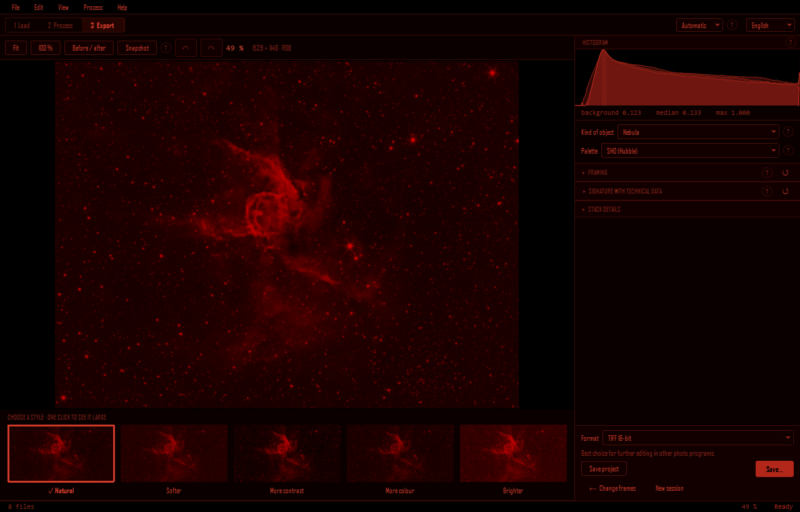

### Keyboard Shortcuts and Mouse Gestures

| Action | Shortcut / Gesture |
|---|---|
| Open `.pixastro` project | `Ctrl+O` |
| Save `.pixastro` project | `Ctrl+S` |
| Export image | `Ctrl+E` |
| Quit PixAstro | `Ctrl+Q` |
| Undo / Redo edit | `Ctrl+Z` / `Ctrl+Y` or `Ctrl+Shift+Z` |
| Remove selected frames (in Load) | `Delete` |
| Multi-select frames (in Load) | `Ctrl+click` / `Shift+click` |
| Zoom / Pan inside viewer | Mouse wheel / Drag |
| Slide Before / after comparison curtain | Drag the vertical divider line |
| Pan via Navigator minimap (when zoomed in) | Click or drag inside the bottom-right thumbnail |
| Set or clear quality threshold (in Process) | Drag vertically across the chart / Double-click |
| Force-keep a rejected frame (in Process) | Right-click its red-outlined bar |

---

## 4. Step 1: Load Frames and Network Import

In **1 Load**, you import your session frames (lights, darks, flats, bias, or an existing stack), review automatic frame classification, inspect individual exposures, and prepare the run.

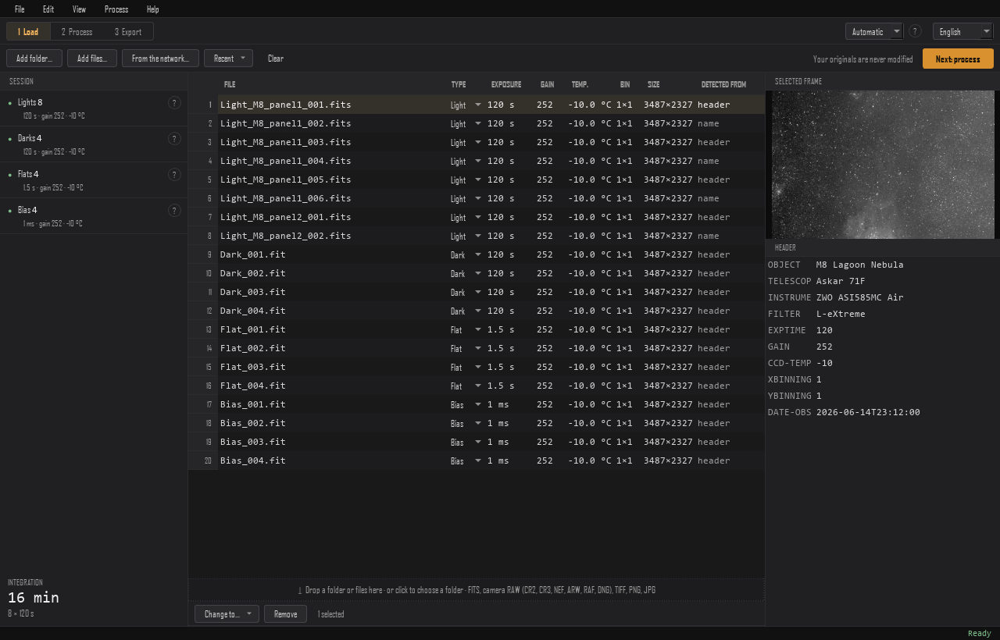

### Supported Formats and Automatic Cleanup

- **Supported input formats**:
  - **Uncompressed FITS** (`.fit`, `.fits`, `.fts`): mono, RGB colour, and Bayer CFA.
  - **Camera RAW**: `.cr2`, `.cr3`, `.nef`, `.arw`, `.raf`, `.dng`, `.orf`, `.rw2`, `.pef`, `.srw` (decoded via LibRaw).
  - **16- or 32-bit TIFF** (`.tif`, `.tiff`), **PNG** (`.png`), and **JPG** (`.jpg`, `.jpeg`).
- **Automatically ignored files**: preview thumbnails (`_thn`, `_thumb`, `_thumbnail`, `_preview`) saved by ASIAIR or Seestar, Dwarf `stacked*` previews, and companion JPEGs from DSLR RAW+JPEG mode are automatically filtered out when RAW or FITS frames exist in the same session.
- **Unsupported**: `fpack`-compressed FITS (`.fz`); save uncompressed FITS from your capture software or decompress with `funpack`.
- **Recommendation**: always prefer RAW or FITS over JPG/PNG, as camera-processed images contain baked-in tone curves, sharpening halos, and compression artefacts.

### Adding Frames

1. **Drag and drop**: drop folders or files onto the drop zone (or click it to pick a folder).
2. **Toolbar buttons**:
   - **Add folder…**: recursively scans a folder and all subfolders.
   - **Add files…**: selects individual files.
   - **From the network…**: copies and imports sessions directly over Wi-Fi/LAN from a smart telescope or shared network folder (details below).
   - **Recent**: quick dropdown of the last 10 added folders (ideal for adding your dark/bias/flat library folders in one click).
   - **Clear**: clears the loaded list (never deletes files on disk).

### Importing Directly from Telescopes over the Network (`From the network…`)

With **From the network…**, you can browse and copy frames straight from smart telescopes and controllers on your home Wi-Fi (or with your computer connected to the telescope's own hotspot), without shuffling USB drives:

- **Supported devices and hotspot addresses**:
  - **ZWO ASIAIR** (SMB/Samba).
  - **ZWO Seestar** (SMB — `10.0.0.1` on the Seestar's own Wi-Fi).
  - **Dwarf 3 and Dwarf mini** (anonymous FTP — `192.168.88.1` on the Dwarf's own Wi-Fi; prefix with `ftp://` if you want to force FTP).
  - **Celestron Origin** (SMB — `origin.local`).
  - **Vaonis Vespera** (FTP/SMB — `10.0.0.1` on the Vespera's own Wi-Fi).
  - **Other network devices** (Windows/Linux SMB/Samba shares or local FTP servers).

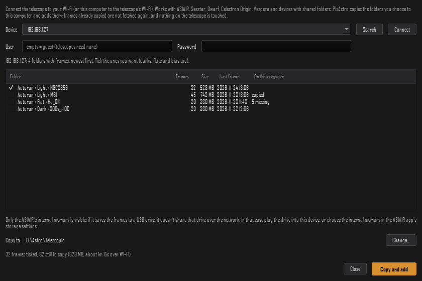

1. Click **Search** to auto-discover compatible devices on the local network; PixAstro recognises ASIAIR, Seestar, Dwarf, Celestron Origin, and Vespera automatically and shows their IP address and device name. You can also type an IP or hostname (`origin.local`) directly into **Device** and click **Connect**.
2. Leave **User** and **Password** blank for telescope guest / anonymous FTP access (other Windows/Linux shares may require credentials).
3. Tick the folders you want to fetch in the folder table (newest sessions appear at the top; include darks, flats, and bias if present). The **On this computer** column shows `copied` or `N missing`.
4. Choose your local destination folder with **Change…** (defaults to *Pictures/PixAstro/<device name>*).
5. Click **Copy and add**. Files already present locally with the same size are skipped (incremental resume), interrupted downloads write `.part` files cleanly without leaving corrupt frames, nothing on the telescope is altered, and copied folders are immediately loaded and classified.

> [!IMPORTANT]
> **Smart-telescope raw saving & ASIAIR USB storage**: Some telescopes only retain individual subframes when enabled in their companion app: turn on **`Save Each Frame`** on **Seestar**, **`Save Raw Images`** on **Celestron Origin**, or **`RAW images (FITS)`** on **Vespera**. On **ASIAIR**, only the internal memory (`EMMC Images`) is exposed over the network; if your ASIAIR saves captures to an attached USB drive, plug that USB drive directly into your computer instead.

### Session Summary, Classification, and Notices

The left **SESSION** panel displays counts and common exposure, gain/ISO, and sensor temperature for all four frame types, plus total **INTEGRATION**:

- **Lights**: your deep-sky object frames (green dot when present; red if missing).
- **Darks**: lens-cap frames matching light exposure and temperature to subtract thermal pattern and hot pixels.
- **Flats**: evenly illuminated frames taken at the same focus and optical orientation to fix vignetting and dust doughnuts.
- **Bias**: shortest-exposure cap-on frames measuring sensor readout baseline, especially helpful for flat calibration and scaling darks.

Collapsible notice cards appear at the bottom of the **SESSION** panel whenever calibration frames are missing, fewer than 5 lights are present, camera/size/gain/temperature mismatches exist between calibration and lights, unreadable files are found (highlighted in red in the table), an already-stacked image is detected, or compatible **Calibration library** darks are ready to substitute automatically.

### Frame Table, Manual Overrides, and Selected Frame Preview

- **Columns**: `File`, `Type`, `Exposure`, `Gain`, `Temp.`, `Bin`, `Size`, and `Detected from` (`header`, `name`, `content`, or `you`).
- **Override frame type**: change the **Type** dropdown on any row, or select multiple rows (`Ctrl` / `Shift`) and use **Change to…** (or right-click) to batch-assign `Light`, `Dark`, `Flat`, or `Bias`.
- **Remove frames**: click **Remove**, right-click → **Remove**, or press `Delete` (removes from the session list only; files on disk remain untouched).
- **Right panel (`SELECTED FRAME` & `HEADER`)**: clicking any row renders an auto-stretched preview to verify framing, focus, or clouds, and lists all FITS header tags or image metadata below.

### Special Workflows Handled Automatically

- **Already stacked input**: dropping a single stack from PixInsight, Siril, DeepSkyStacker, Astro Pixel Processor, ASTAP, Sequator, or PixAstro's own 32-bit FITS skips calibration/alignment/stacking and jumps straight to border cropping and post-processing.
- **Monochrome cameras with filters**: load lights and flats for all filters at once. PixAstro reads `FILTER` headers, folder names, or filenames (`L`, `Lum`, `R`, `Red`, `G`, `B`, `Ha`, `OIII`, `SII`, etc.), stacks each filter with its matching flats, and composites **LRGB**, **RGB**, **HOO**, or **SHO**. Mixing narrowband filters with RGB frames uses narrowband for nebulosity and RGB for true star colours.
- **Colour cameras with dual-band filters**: recognises dual-band filters (L-eXtreme, L-eNhance, L-Ultimate, ALP-T, SV220, Askar C1/C2/D1/D2, L-Synergy, Seestar dual-band) as well as broadband/light-pollution/tri-band RGB filters (`UV/IR`, `L-Pro`, `LPS`, `Tri-Band RGB Ultra`). Combining one Hα/OIII session with one SII/OIII session produces **SHO**; combining one dual-band Hα/OIII session with a normal colour session creates **HaRGB**, boosting emission signal while keeping natural star colours.
- **Mixed exposures and automatic HDR**: equalises signal across different exposure lengths weighted by SNR; when exposures differ by more than 1.5× and bright cores saturate (such as M42 or M31), PixAstro merges an **HDR** stack recovering saturated regions from short exposures.
- **Multi-panel mosaics**: load overlapping panels together (at least 15% overlap recommended); PixAstro detects each pointing, stacks each panel independently, aligns overlapping star fields, and blends background levels seamlessly (also works with pre-stacked panels of differing sizes).

Click **Next: process** to continue.

---

## 5. Step 2: Process and Stack

In **2 Process**, PixAstro executes calibration, quality scoring, star alignment, outlier-rejected stacking, and initial post-processing.

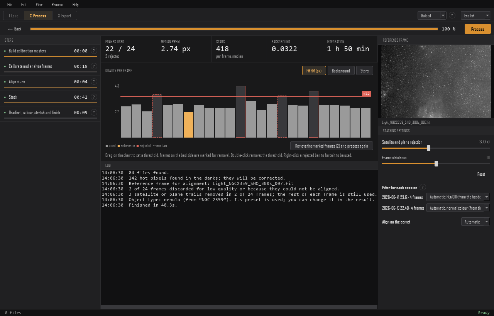

### The 5 Processing Stages

1. **Build calibration masters**: stacks bias, darks, and flats. Automatically discards saturated/overexposed flats and uses adaptive dark optimization to subtract only the repeatable sensor pattern without adding dark-frame noise.
2. **Calibrate and analyse frames**: applies masters, removes persistent hot pixels, and measures star count, sharpness (**FWHM**), roundness (**eccentricity**), **background**, and noise per frame, automatically rejecting severely degraded subframes.
3. **Align stars**: matches star triangles across frames and warps all lights onto the sharpest reference frame (or performs separate comet-nucleus alignment in comet mode).
4. **Stack**: runs iterative sigma-clipping rejection (`kappa`) to eliminate satellites, aircraft, cosmic rays, and hot pixels, detects and masks long linear satellite trails inside individual frames without discarding the rest of the frame, scales mixed exposures, and reduces noise via half-stacks / neural cleanup. Multi-panel datasets are stitched into a mosaic.
5. **Gradient, colour, stretch and finish**: crops non-overlapping borders and applies the initial object-tailored post-processing pipeline.

### Live Metrics, Interactive Quality Chart, and Log

- **Top summary tiles**: `Frames used` (plus rejected count), `Median FWHM` (pixels), `Stars` (median per frame), `Background`, and effective `Integration` time.
- **Interactive `QUALITY PER FRAME` chart**:
  - Switch displayed metric with **`FWHM (px)`**, **`Background`**, or **`Stars`**.
  - Bar colours: grey (**used**), amber (**reference**), solid red outline (**rejected**), dashed horizontal line (**median**). Hover any bar for filename, exact FWHM, star count, and background.
  - **Interactive threshold cut**: after analysis/stacking, **drag vertically on the chart** to place a red cutoff line (e.g., `≤ 3.5` on FWHM or `≥` on Stars). Frames falling on the bad side receive a dashed red outline and the button **Remove the marked frames (N) and process again** appears. **Double-click** the chart to clear the threshold.
  - **Force-keep a rejected frame**: **right-click** any solid red-outlined bar to force inclusion (highlighted with a dashed amber outline), then click **Also use the forced frames (N) and process again** (frames lacking enough stars or failing alignment cannot be forced).
- **`LOG` panel**: timestamped activity entries, detections, and warnings (highlighted in amber).
- **Right panel (`REFERENCE FRAME` / `PARTIAL STACK`)**: shows the selected alignment reference frame before stacking, and transitions to a live **Partial stack** preview while frames accumulate.

### Guided Mode Stacking Settings

Switch the top-right selector to **Guided** to configure stacking parameters before clicking **Process**:

| Setting | Range / Options | Description |
|---|---|---|
| **Satellite and plane rejection (`kappa`)** | `1.5 σ` – `5.0 σ` (default `3.0 σ`) | Standard-deviation threshold for pixel rejection. Lower values reject more trails (and slightly more signal); higher values keep more signal. |
| **Frame strictness (`strictness`)** | `0.0` – `2.0` (default `1.0`) | Strictness when discarding blurry, trailed, or cloudy frames. `0.0` keeps every alignable frame. |
| **Filter for each session** | `Automatic`, `Normal colour`, `Dual-band Hα/OIII → HOO`, `Dual-band SII/OIII` | Appears when colour-camera sessions are detected (>8 hours apart or in separate folders), letting you confirm or override the filter used each night. |
| **Align on the comet** | `Automatic`, `Yes`, `No` | Separates stars from the comet with AI, stacks the comet aligned on its nucleus and the stars aligned on themselves (cleanly handling pre-aligned zero-padded borders, cold defects, and variable stars), and recombines them for pinpoint stars and a crisp comet. `Automatic` enables when the target name matches comet notation (e.g. `161P`, `C/2025 A6`). Requires at least 4 distinct `DATE-OBS` timestamps. |
| **Reset** | Button | Restores `3.0 σ`, `1.0`, automatic filters, and automatic comet mode. |

---

## 6. Step 3: Result, Guided Adjustments, Framing, Signature, and Export

In **3 Export**, you can inspect, compare, pick styles or object presets, fine-tune every post-processing step live, frame and crop, stamp a technical signature and ASTAP sky labels, and save your final image.

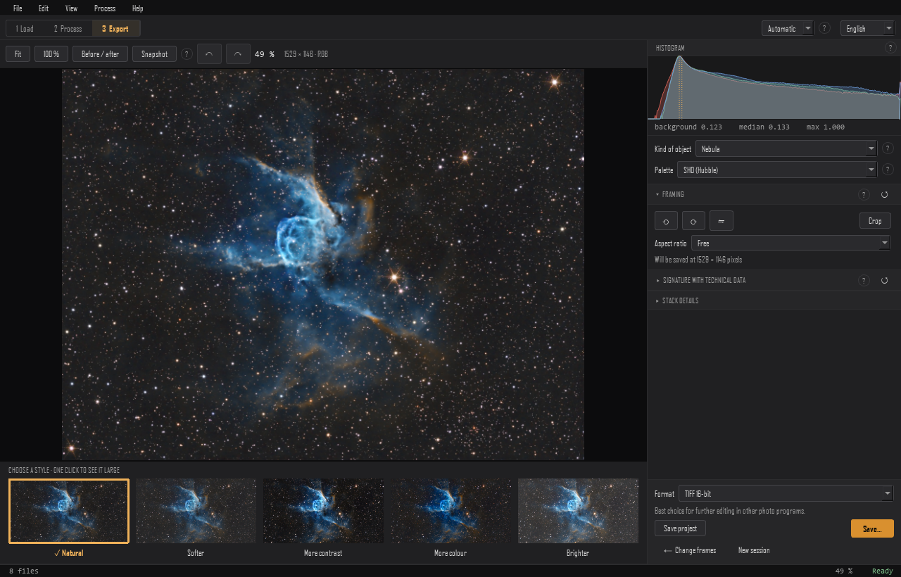

### Viewer, Before/After Curtain, Snapshot, and Undo History

The viewer toolbar provides:

- **Fit** / **100 %**: scales the image to fit the viewport or switches to native 1:1 pixels (zooming past preview scale automatically triggers a full-resolution render in the background). When zoomed in, a bottom-right **Navigator** minimap lets you pan with a click or drag.
- **Before / after**: toggles an interactive vertical comparison curtain showing the plain stretched stack on the left and the processed image on the right.
- **Snapshot**: freezes the current processed view as the "before" side of the curtain (a **×** button appears next to it to revert back to the raw stack). Ideal for A/B testing incremental tweaks.
- **↶ / ↷ (`Ctrl+Z` / `Ctrl+Y`)**: 100-step undo/redo history covering parameters, presets, and framing edits.
- **Zoom & image readout** (`48 % · 1529 × 1146 · RGB` or `mono`), plus live render status (`Updating preview…`, `Computing at full resolution… %`).

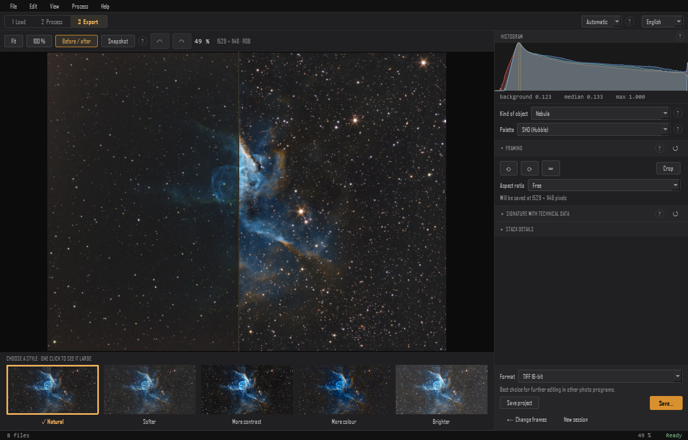

### Histogram, Kind of Object, Palette, and Quick Styles

The top of the right panel houses controls shared across Automatic and Guided modes:

- **Logarithmic per-channel Histogram** + **?**: plots pixel distribution alongside dashed `background` and `median` markers plus `max` readout. A peak separated from the left edge indicates unclipped sky background.
- **Kind of object**: `General`, `Nebula`, `Galaxy`, `Star cluster`, `Milky Way (wide field)`. Auto-detected from object metadata/filenames or emission colour, and freely changeable at any time.
- **Palette** *(shown for colour and narrowband datasets)*:

| Palette | Mapping / Result |
|---|---|
| **Automatic** | Uses the natural default palette for your filter combination (SHO, HOO, or normal colour). |
| **SHO (Hubble)** | SII → Red, Hα (green-attenuated) → Green, OIII → Blue: classic golden-and-blue Hubble look. |
| **HOO (Hα and OIII)** | Hα → Red, OIII → Green/Blue (teal). |
| **HOS (Hα, OIII, SII)** | Hα → Red, OIII → Green, SII → Blue. |
| **HSO (Hα, SII, OIII)** | Hα → Red, SII → Green, OIII → Blue. |
| **Natural (human vision)** | Approximates human eye colour response (SII/Hα red, OIII teal/blue). |
| **Hubble style (synthetic)** | Emulates golden/blue Hubble hues from Hα + OIII data alone (when no SII filter was used). |
| **SHO, untouched (green)** | Direct unattenuated mapping where dominant Hα renders strongly green. |
| **Natural colour** | Forces standard broadband RGB processing (helpful if a colour/tri-band filter was misclassified as dual-band). |

- **Choose a style (Automatic mode)**: bottom thumbnail strip generated from your image with 5 one-click looks: **`Natural`**, **`Softer`**, **`More contrast`**, **`More colour`**, and **`Brighter`**.

### Complete Guided Mode Reference (7 Post-Processing Cards)

Switching to **Guided** reveals seven collapsible adjustment cards. Each card has a **?** help button and a **↺** reset button to restore just that step to automatic defaults.

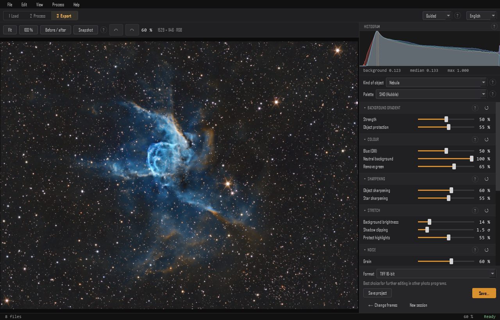

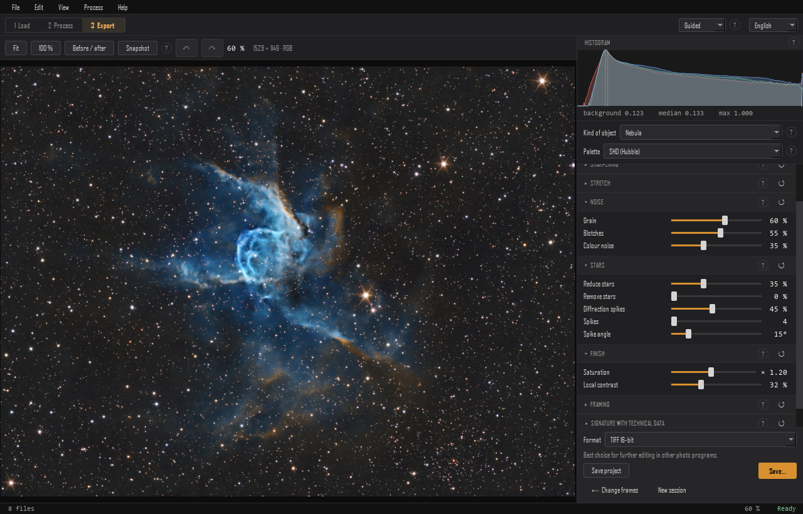

| Card | Slider | Range | Purpose |
|---|---|---|---|
| **Background gradient** | `Strength` | `0 %` – `100 %` | Models and subtracts uneven sky illumination (light pollution, Moon, horizon). `0 %` leaves the background untouched; higher values tackle steeper gradients (take care on very large nebulae). |
| **Background gradient** | `Object protection` | `0 %` – `100 %` | Prevents extended nebulae or the Milky Way from being treated as sky background. |
| **Colour** | `White balance` / `Blue (OIII)` | `0 %` – `100 %` | On RGB data, balances colours so stars average neutral white (`0 %` = raw camera colour). On **SHO** composites, adjusts the OIII blue contribution (midpoint `50 %` = standard; half to double). |
| **Colour** | `Neutral background` | `0 %` – `100 %` | Neutralises sky colour casts (greenish, orange streetlamp glow, etc.). |
| **Colour** | `Remove green` | `0 %` – `100 %` | Removes sensor green cast (SCNR). Lower this when imaging naturally green comets. |
| **Sharpening** *(offline AI)* | `Object sharpening` | `0 %` – `100 %` | Built-in neural-network PSF deconvolution sharpening dust lanes, filaments, and spiral arms without ringing or added grain. |
| **Sharpening** *(offline AI)* | `Star sharpening` | `0 %` – `100 %` | Tightens and rounds stars independently of the object, including field corners. |
| **Stretch** | `Background brightness` | `8 %` – `40 %` | Sets final sky background brightness. Raise to reveal faint outer nebulosity (also reveals more background noise). |
| **Stretch** | `Shadow clipping` | `1.0 σ` – `4.5 σ` | Distance in standard deviations between sky median and black point. Higher values raise the black floor (lower contrast, softer veil). |
| **Stretch** | `Protect highlights` | `0 %` – `100 %` | HDR highlight compression keeping bright compact nebulae and cores (M42 Trapezium, M31 nucleus, compact targets like M57, and bright star halos) unclipped. |
| **Noise** *(offline AI)* | `Grain` | `0 %` – `100 %` | Smooths fine 1–2 px background grain while preserving stars and target structure. |
| **Noise** | `Blotches` | `0 %` – `100 %` | Smooths broader 4–32 px background mottling independently of fine grain. |
| **Noise** | `Colour noise` | `0 %` – `100 %` | Removes green/magenta chromatic noise blotches in the background. |
| **Stars** | `Reduce stars` | `0 %` – `100 %` | Shrinks stretched star profiles to keep dense star fields from masking nebulae (keep low on star clusters). |
| **Stars** *(offline AI)* | `Remove stars` | `0 %` – `100 %` | Removes stars via built-in AI (`100 %` = completely starless; intermediate values dim stars). When exporting TIFF/PNG/JPG with value `> 0`, a separate `*-stars` layer file is saved alongside automatically. |
| **Stars** | `Diffraction spikes` | `0 %` – `100 %` | Adds physically modelled Newtonian diffraction spikes coloured by each star's real hue. |
| **Stars** | `Spikes` | `4` or `6` | Number of spikes (2-vane cross spider or 3-vane spider). |
| **Stars** | `Spike angle` | `0°` – `90°` | Orientation angle in degrees. |
| **Finish** | `Saturation` | `× 0.50` – `× 2.00` | Perceptual colour richness applied strictly above the dark background so noise isn't saturated. |
| **Finish** | `Local contrast` | `0 %` – `100 %` | Enhances medium-scale structural contrast across filaments, dust, and spiral arms without touching sky background. |

### Framing (Rotate, Flip, and Crop)

The **FRAMING** card works identically in Automatic and Guided modes:

- **Rotate left (`⟲`) / Rotate right (`⟳`)**: lossless 90° rotations.
- **Flip (mirror) (`⇋`)**: horizontal mirror flip.
- **Crop / Done**: activates an interactive crop rectangle with **rule-of-thirds** guides directly in the viewer. Drag edges, corners, or the interior, then click **Done**.
- **Aspect ratio**: `Free`, `Original`, `1:1`, `3:2`, `2:3`, `4:5`, `16:9`, `9:16`.
- Displays exact output dimensions (`Will be saved at W × H pixels`). **All colour and brightness calculations run on the full uncropped image**, so cropping never shifts colour balance. Click **↺** to reset rotation, flip, and crop.

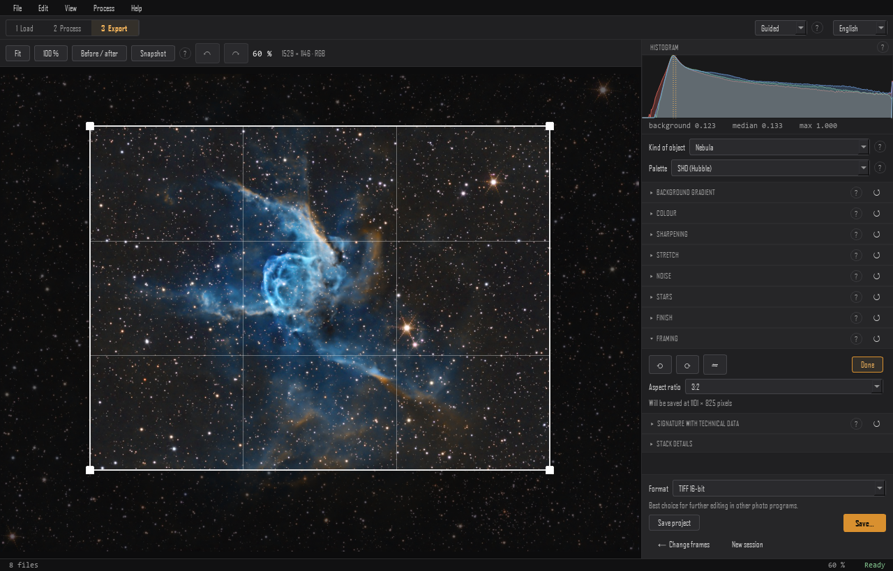

### Signature with Technical Data and Sky Object Labels (ASTAP)

The **SIGNATURE WITH TECHNICAL DATA** card overlays a clean session legend and astrometric annotations when exporting to **TIFF**, **PNG**, or **JPG** (32-bit linear **FITS** files are always saved untouched without text or graphics):

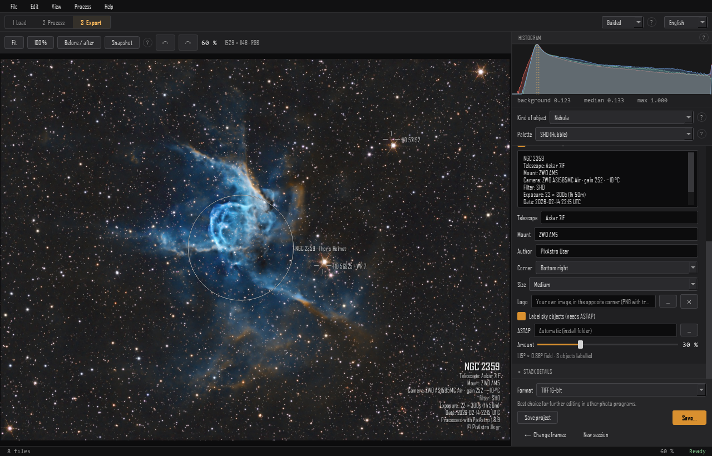

- **Add when saving**: enables the metadata corner stamp showing target name (large heading), telescope, mount, camera, gain, temperature, filter, total exposure, UTC date, and PixAstro credit. Every line is **freely editable** in the text box (**↺** restores the suggested text).
- **Telescope** & **Mount**: entries typed here are **remembered per camera** (helpful if your capture app writes the mount name into `TELESCOP`).
- **Author** (`©`), **Corner** (`Bottom left`, `Bottom right`, `Top left`, `Top right`), **Size** (`Small`, `Medium`, `Large`, `Extra large`).
- **Logo**: pick a custom image (PNG with transparency recommended) placed in the opposite corner along the same edge.
- **Label sky objects (needs ASTAP)**:
  1. Requires [**ASTAP**](https://www.hnsky.org/astap.htm) (free) installed with a star database and `deep_sky.csv` catalogue.
  2. PixAstro auto-detects standard ASTAP install locations, or you can browse directly to the `astap` executable via **…**.
  3. Plate-solves the image, reports field of view in degrees and number of labelled objects, and draws scaled circles around deep-sky objects (Messier, NGC, IC, Sharpless, Barnard, LDN/LBN, etc.) plus reticles on notable stars.
  4. The **Amount** slider (`0 %` – `100 %`, default `30 %`) filters label density live from major targets only up to minor catalogues, unnamed dark nebulae, and extra stars.

### Stack Details, Warnings, and Export

- **STACK DETAILS**: expands full session statistics (stacked frames, exposure, pixel size, mosaic panels, reference frame, elapsed time) plus a per-frame list marked `★` (reference), `✓` (used with stars & FWHM), and `✗` (rejected with exact reason). Equipment/session warnings appear beneath.
- **Export formats**:

| Format | Bit depth | Profile / Metadata | Best use |
|---|---|---|---|
| **TIFF 16-bit** | 16-bit per channel (zlib) | Stretched, **sRGB** ICC profile + JSON metadata | Best choice for further retouching in Photoshop, Lightroom, GIMP, or Affinity. |
| **FITS 32-bit** | 32-bit float (`TOP-DOWN`) | **Unstretched linear stack**, no signature + FITS headers (`PIXSTACK`) | Reload into PixAstro later without restacking, or continue linear work in astronomy software (looks nearly black in regular image viewers). |
| **PNG 16-bit** | 16-bit per channel | Stretched, **sRGB** + `gAMA` + UTF-8 text | Lossless high-bit sharing. |
| **JPG** | 8-bit (95% quality) | Stretched, **sRGB** ICC profile + UTF-8 comment | Small file size for social media and messaging. |

- **Save project**: writes a `.pixastro` file storing frames, settings, and linear stack.
- **← Change frames**: returns to `1 Load` keeping your file list intact so you can add/remove frames and restack.
- **New session**: resets the workspace after checking for unsaved changes.

---

## 7. Projects, Object Queue, and Calibration Library

### PixAstro Projects (`.pixastro`)

Available from **File → Save project…** (`Ctrl+S`), **File → Open project…** (`Ctrl+O`), or **Save project** on Step 3:

- Stores frame paths, classification, stacking parameters (`kappa`/`strictness`), Guided post-processing settings, preset, framing, and the computed linear stack.
- Reopening a `.pixastro` file (or dropping it onto the window) restores Step 3 immediately without restacking.
- **Change detection**: if frames on disk were added, removed, or modified since saving, PixAstro informs you and keeps your classification and settings ready to restack.
- **Unsaved protection**: closing the window or starting a new session with an unsaved result prompts you to **Save project…**, **Discard**, or **Cancel**.

### Object Queue (`File → Object queue…`)

The **Object queue** processes multiple deep-sky session folders sequentially in **Automatic mode** without disturbing your active workspace—ideal for running multiple targets overnight.

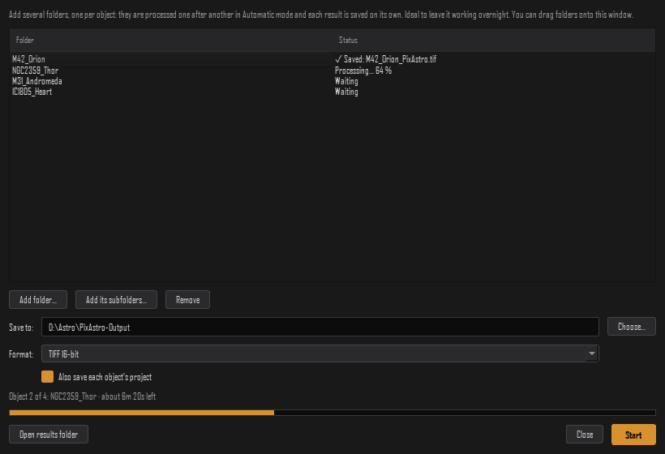

1. Add folders by dropping them onto the window, clicking **Add folder…**, or clicking **Add its subfolders…** (for example, pick an ASIAIR `Light` folder to enqueue every target subfolder inside).
2. Set the destination folder via **Choose…** and select the output format (`TIFF 16-bit`, `FITS 32-bit`, `PNG 16-bit`, or `JPG`).
3. Keep **Also save each object's project** ticked if you want a `.pixastro` saved alongside each output so you can tweak it later in Guided mode without restacking.
4. Click **Start**. Each target tracks its status (`Waiting`, `Processing… %`, `✓ Saved`, or `✗` if one target errors without stopping the queue) and overall ETA.
5. Cancelling mid-queue preserves every target already saved. Click **Open results folder** to jump straight to the outputs.

### Calibration Library

Enabled by default (**Process → Use the calibration library**):

- Whenever a session includes at least **5 darks or 5 bias** frames, PixAstro saves their calibration masters along with camera metadata (`INSTRUME`, resolution, Bayer pattern, gain, offset, binning, temperature, exposure) in the `calibracion` folder.
- On future sessions missing darks or bias, PixAstro matches a compatible master from the same camera (within **±3 °C** temperature, matching gain, and exposure within **±5%**—or up to 0.5×–2× when bias is available for dark scaling) and applies it automatically.
- **Flats are never stored in the library**, because dust spots and optical orientation vary across nights.
- Library disk usage is capped at **4 GB** (least-recently-used entries are evicted automatically when exceeded). Open it anytime via **Process → Open the calibration library folder**.

---

## 8. Command-Line Interface (CLI)

The desktop executable runs headlessly from any terminal (PowerShell/CMD on Windows, Terminal on Linux/macOS):

- **Windows**: `PixAstro.exe` (or `.venv\Scripts\python -m pixastro` from source)
- **Linux**: `./PixAstro`
- **macOS**: `/Applications/PixAstro.app/Contents/MacOS/PixAstroApp`

### Global Options and Subcommands

| Flag / Subcommand | Description |
|---|---|
| `--version` | Prints the installed version. |
| `--lang {de,en,es,fr,it,pt,zh}` | Sets console message language. |
| `analyze <inputs...>` | Displays automatic frame classification (`Light`/`Dark`/`Flat`/`Bias`) and detection reason without stacking. |
| `process <inputs...> -o <output>` | Runs the full calibration, alignment, stacking, and post-processing pipeline and writes the final image. |

#### `process` Options

| Flag | Default | Description |
|---|---|---|
| `-o`, `--output` *(required)* | — | Output file (`.tif`, `.fits`, `.png`, `.jpg`). |
| `-f`, `--format` | from extension | Explicit output format (`tiff`, `fits`, `png`, `jpg`). |
| `--kappa <float>` | `3.0` | Pixel rejection in standard deviations (`0` = plain mean). |
| `--strictness <float>` | `1.0` | Frame rejection strictness (`0` = keep all, `1` = normal, `2` = strict). |
| `--preset` | `auto` | Target preset: `auto`, `nebula`, `galaxy`, `cluster`, `milkyway`. |
| `--no-crop` | off | Disables automatic edge border cropping. |
| `--no-mosaic` | off | Processes only the primary pointing instead of stitching multi-panel mosaics. |
| `--temp <folder>` | system temp | Custom folder for temporary files. |

### Usage Examples

```bash
# Inspect automatic classification without processing
PixAstro.exe analyze "D:\Astro\M42"

# Process a nebula and export 16-bit TIFF
PixAstro.exe process "D:\Astro\M42" -o "D:\Astro\M42_final.tif" --preset nebula

# Process with Spanish messages, stricter rejection, and linear 32-bit FITS output
PixAstro.exe --lang es process "D:\Astro\M31" -o "M31.fits" --kappa 2.5 --strictness 1.5
```

---

## 9. Warnings, Diagnostics, Troubleshooting, and Support

### Automatic Equipment Diagnostics

After alignment and quality analysis, PixAstro inspects star shapes across the field and timeline, alerting you when optical or tracking issues appear:

- **Sensor tilt**: stars are consistently wider toward one edge than the opposite edge across every measured frame; inspect optical-train seating and adapters.
- **Elongated stars in corners**: round stars at centre with elongated corners; indicates sub-optimal flattener/reducer backfocus (or field curvature/coma if no corrector is used).
- **Trailed stars**: stars elongated even at the centre across multiple frames; check autoguiding, mount balance, wind, or exposure length.
- **Focus drift during the night**: FWHM steadily climbs over hours due to temperature drop or falling target elevation; periodic refocusing or an autofocuser helps.

### Common Errors and How to Fix Them

| Message / Situation | Likely cause | Recommended action |
|---|---|---|
| **"… is a compressed FITS"** | `.fz` / `fpack`-compressed FITS file. | Save uncompressed FITS from your capture software or decompress with `funpack`. |
| **"No stars found in the frames"** | Severe defocus, clouds, or daytime test shots. | Check frame previews in `1 Load` and remove frames without stars. |
| **"Overexposed flats"** | Flat histogram hits sensor saturation. | Retake flats at shorter exposure with histogram peak around 1/3 to 1/2. |
| **"Noisy darks / different exposure"** | Too few darks, mismatched temperature, or different exposure without bias frames. | Capture 20–30 darks at matching temperature and exposure, or add bias frames to enable dark scaling. |
| **"Mosaic reduced / too large"** | Full mosaic exceeds available system RAM. | Close other applications or process fewer panels at once; PixAstro reduces scale or falls back to the main panel automatically. |
| **"ASTAP not found / Missing deep_sky.csv"** | ASTAP isn't installed in default paths or lacks a catalogue. | Install ASTAP + star database (`D50`/`D80`/`H18`) from `hnsky.org/astap.htm` and set its executable path in the Signature card. |
| **"Can't connect to the device" / empty network folder** | Wrong IP, different Wi-Fi network, ASIAIR USB drive, or individual raw saving off on telescope. | Share the same Wi-Fi or join the telescope hotspot (**Seestar / Vespera**: `10.0.0.1`, **Dwarf**: `192.168.88.1`, **Origin**: `origin.local`) and click **Search**. Turn on *Save Each Frame* (Seestar), *Save Raw Images* (Origin), or *RAW images (FITS)* (Vespera). On ASIAIR, only internal `EMMC Images` is shared over SMB. |

### Activity Logs and Contacting Support

If you encounter an unexpected issue or wish to suggest an improvement:

1. Open **Help → Open activity log folder** to locate the latest `pixastro.log` file.
2. Click **Help → ✉ Suggestions or problems…** to draft an email pre-filled with your PixAstro version and OS details (or copy the support email address) and attach the log along with a brief description of your session.
