# PixAstro: Manual de usuario completo (Escritorio)

*Manual oficial para **Windows**, **macOS** y **Linux** · [English manual](MANUAL_EN.md) · [Descargar en PDF](PixAstro-Manual-ES.pdf)*

> [!NOTE]
> Este manual cubre todas las funciones de **PixAstro** en su versión de escritorio (Windows, macOS y Linux): el asistente en 3 pasos (**Cargar → Procesar → Exportar**) en **Modo Automático** y **Modo Guiado**, la **Cola de objetos**, la **Biblioteca de calibración**, la transferencia por red desde telescopios (**ASIAIR**, **Seestar**, **Dwarf**, **Celestron Origin**, **Vespera**), el **etiquetado astrométrico con ASTAP**, el **Modo nocturno** y la **Línea de comandos (CLI)**.

---

## Índice

- [1. Introducción y requisitos](#1-introducción-y-requisitos)
- [2. Descarga, instalación, actualizaciones y carpetas de datos](#2-descarga-instalación-actualizaciones-y-carpetas-de-datos)
- [3. Vista general, barra de menús, modo nocturno y atajos](#3-vista-general-barra-de-menús-modo-nocturno-y-atajos)
- [4. Paso 1: Cargar tomas y traer sesiones por red](#4-paso-1-cargar-tomas-y-traer-sesiones-por-red)
- [5. Paso 2: Procesar y apilar](#5-paso-2-procesar-y-apilar)
- [6. Paso 3: Resultado, ajustes guiados, encuadre, firma y exportación](#6-paso-3-resultado-ajustes-guiados-encuadre-firma-y-exportación)
- [7. Proyectos, Cola de objetos y Biblioteca de calibración](#7-proyectos-cola-de-objetos-y-biblioteca-de-calibración)
- [8. Línea de comandos (CLI)](#8-línea-de-comandos-cli)
- [9. Avisos, diagnósticos, solución de problemas y soporte](#9-avisos-diagnósticos-solución-de-problemas-y-soporte)

---

## 1. Introducción y requisitos

**PixAstro** es una aplicación de procesado de astrofotografía de cielo profundo (nebulosas, galaxias, cúmulos estelares, cometas, mosaicos y Vía Láctea) diseñada para obtener imágenes finales listas para compartir o continuar editando sin necesidad de dominar teoría compleja ni configurar decenas de módulos previos.

### Principios fundamentales

- **Flujo guiado en 3 pasos**: **1 Cargar → 2 Procesar → 3 Exportar**. Arrastras la carpeta con tus tomas, pulsas **Procesar** y obtienes el resultado final.
- **Modo Automático y Modo Guiado**: En **Automático**, PixAstro mide tus datos y elige los valores óptimos; en **Guiado**, desbloqueas el control fino con deslizadores en tiempo real, explicación contextual («**?**») en cada concepto y botón **↺** para restaurar el valor automático de cada tarjeta.
- **100 % local y sin conexión**: Todo el procesado —incluidas las redes neuronales propias de **deconvolución**, **reducción de ruido** y **eliminación de estrellas**— se ejecuta íntegramente en tu equipo. PixAstro no crea cuentas, no sube imágenes ni envía telemetría (la única petición de red opcional es comprobar si existe una versión nueva en GitHub, y puede desactivarse).
- **Respeto absoluto a tus originales**: Los archivos de entrada se abren en modo de solo lectura y nunca se modifican ni se mueven.
- **Multilingüe en caliente**: Disponible en **español**, **inglés**, **alemán**, **francés**, **italiano**, **portugués** y **chino**, con cambio instantáneo desde la barra superior o el menú **Ver**.

### Requisitos del sistema y rendimiento

| Aspecto | Especificación |
|---|---|
| **Windows** | Windows 10 u 11 de 64 bits |
| **macOS** | macOS 14 (Sonoma) o posterior en Apple Silicon (M1 o superior); macOS 12 (Monterey) o posterior en Mac Intel |
| **Linux** | x86-64 con `glibc` 2.35 o posterior (Ubuntu 22.04, Debian 12, Fedora 36, Mint 21 o posteriores) |
| **Tarjeta gráfica (GPU)** | No requiere GPU dedicada; utiliza todos los núcleos de la CPU |
| **Memoria RAM** | 8 GB suficientes incluso para sesiones grandes (el apilado trabaja toma a toma; pico medido de ~4,2 GB con tomas de 24 MP en color). Mosaicos grandes pueden requerir más memoria (unos 4 GB para 25 MP) |
| **Espacio temporal en disco** | ~150 MB por toma de 24 MP en color para caché rápida (si falta espacio, avisa y procesa más despacio sin caché) |
| **Velocidad de referencia** | ~3,5 s por toma de 24 MP en un equipo de sobremesa actual (~12 min para 200 tomas) |

---

## 2. Descarga, instalación, actualizaciones y carpetas de datos

Descarga la última versión desde [GitHub Releases](https://github.com/plastelino/pixastro/releases/latest) (o en Windows desde [Microsoft Store](https://apps.microsoft.com/detail/9PFCW3W4D2HH)).

| Plataforma | Archivo | Puesta en marcha |
|---|---|---|
| **Windows 10/11 (64 bits)** | `PixAstro-<versión>-windows-x64.zip` | Descomprímelo entero en una carpeta y abre `PixAstro.exe`. Portable: no requiere instalación ni modifica el registro. |
| **Windows (Microsoft Store)** | Aplicación oficial de Store | Instalación gestionada y firmada por Microsoft; las actualizaciones llegan por Microsoft Store. |
| **macOS Apple Silicon (M1+)** | `PixAstro-<versión>-macos-arm64.dmg` | Abre el `.dmg` y arrastra **PixAstro** a **Aplicaciones**. Firmada y notarizada por Apple. |
| **macOS Intel** | `PixAstro-<versión>-macos-x86_64.dmg` | Abre el `.dmg` y arrastra **PixAstro** a **Aplicaciones**. Firmada y notarizada por Apple. |
| **Linux x86-64** | `PixAstro-<versión>-linux-x86_64` | Concede permiso de ejecución una vez (`chmod +x PixAstro-*-linux-x86_64` o *Propiedades → Permisos → Permitir ejecutar*) y ábrelo con doble clic o desde terminal. |

> [!NOTE]
> **Primer arranque en Linux y librerías del sistema**: En Linux el binario de un solo archivo se descomprime una sola vez en `~/.cache/PixAstro/<versión>` antes de arrancar, por lo que la primera apertura tarda unos segundos más y las siguientes son rápidas. Son necesarias las librerías estándar de Qt/OpenGL (`libgl1`, `libegl1`, `libxkbcommon-x11-0`, `libxcb-cursor0`). En Windows y macOS ya no hace falta descompresión previa.

### Aviso de Windows SmartScreen y Microsoft Defender

El ejecutable directo de GitHub no cuenta con firma digital comercial, por lo que la primera vez Windows puede mostrar la pantalla **«Windows protegió su PC»**. Pulsa **Más información → Ejecutar de todas formas**. Windows se distribuye como un archivo `.zip` con la carpeta completa del programa para evitar los falsos positivos habituales de antivirus en ejecutables de un solo archivo. Puedes verificar cualquier descarga con el archivo `SHA256SUMS.txt` de cada release o instalar la edición de **Microsoft Store**, firmada por Microsoft.

### Actualizaciones

Al iniciarse, PixAstro consulta la última publicación en GitHub mediante el `curl` del sistema (salvo en la versión de Microsoft Store, donde la propia tienda gestiona las actualizaciones):

- Si hay una versión nueva disponible, aparece el botón **⬆ PixAstro X.Y.Z** en la cabecera.
- Al pulsarlo se muestra la versión nueva, el tamaño de la descarga y las notas de la versión; tras confirmar, se descarga, se verifica su hash **SHA256** y PixAstro se reinicia con la versión nueva:
  - **Windows**: descarga el `.zip` y actualiza los archivos dentro de la misma carpeta (conservando tus accesos directos y la carpeta `PixAstro-data`).
  - **Linux**: sustituye el ejecutable automáticamente.
  - **macOS**: descarga el `.dmg` en *Descargas* y lo abre para arrastrar a *Aplicaciones*.
- Desde **Ayuda → Buscar actualizaciones…** puedes comprobar manualmente en cualquier momento, y en **Ayuda → Avisar de versiones nuevas al arrancar** puedes activar o desactivar la comprobación automática.

### Dónde guarda PixAstro sus archivos

| Qué | Ubicación |
|---|---|
| **Configuración (`settings.json`), registro (`logs/`) y Biblioteca de calibración (`calibracion/`)** | **Windows y Linux**: carpeta `PixAstro-data` junto al ejecutable (si no tiene permisos de escritura, `%APPDATA%\PixAstro` en Windows o `~/.local/share/PixAstro` en Linux).<br>**macOS**: siempre `~/Library/Application Support/PixAstro`. |
| **Archivos temporales del apilado** | Carpeta temporal del sistema o la ruta personalizada en **Proceso → Carpeta de archivos temporales…**. Se borran al terminar (y al arrancar si quedó alguno tras un cierre inesperado). |
| **Programa descomprimido (caché de un solo archivo)** | **Linux**: `~/.cache/PixAstro/<versión>`. En **Windows** y **macOS** no es necesario. |

---

## 3. Vista general, barra de menús, modo nocturno y atajos

Al abrir PixAstro aparece una breve **presentación animada** sobre las nebulosas M8 y M20 mientras se cargan en segundo plano los módulos de procesado (puedes cerrarla al instante con un clic o cualquier tecla cuando termine la carga) y entra directamente en el **asistente de 3 pasos**.

### Barra superior, arrastrar y soltar y barra de estado

- **Indicador de pasos** (`1 Cargar` · `2 Procesar` · `3 Exportar`): muestra en qué fase estás y te permite volver atrás en cualquier paso ya completado sin perder las tomas cargadas ni el apilado calculado.
- **Botón `⬆ PixAstro X.Y.Z`** *(cuando hay actualización)*: abre el diálogo de actualización en un clic.
- **Selector de modo (`Automático` / `Guiado`)** + botón de ayuda **?**: alterna al instante entre simplicidad automática y control completo por parámetros.
- **Selector de idioma**: cambia toda la interfaz al instante (`Deutsch`, `English`, `Español`, `Français`, `Italiano`, `Português`, `中文`).
- **Arrastrar y soltar global**: puedes soltar directamente sobre cualquier parte de la ventana:
  - Una carpeta con tomas o archivos FITS/RAW/TIFF/PNG/JPG → se añaden a **1 Cargar** y comienza la clasificación.
  - Un archivo `.pixastro` → abre directamente el proyecto guardado.
- **Barra de estado inferior**: muestra a la izquierda el resumen de tomas cargadas o apiladas, y a la derecha las coordenadas y valores normalizados del píxel bajo el cursor (`x … y … R … G … B …` o `L …`), el porcentaje de zoom actual y el indicador de estado (**Listo** / **Trabajando**).

### Barra de menús completa

| Menú | Elemento | Atajo | Descripción |
|---|---|---|---|
| **Archivo** | `Añadir carpeta…` | — | Añade recursivamente una carpeta y sus subcarpetas al paso **1 Cargar**. |
| **Archivo** | `Añadir archivos…` | — | Añade archivos sueltos al paso **1 Cargar**. |
| **Archivo** | `Cola de objetos…` | — | Abre el diálogo de procesado automático por lotes de múltiples objetos. |
| **Archivo** | `Abrir proyecto…` | `Ctrl+O` | Abre un archivo de proyecto `.pixastro`. |
| **Archivo** | `Guardar proyecto…` | `Ctrl+S` | Guarda clasificación, ajustes, apilado lineal y encuadre en `.pixastro`. |
| **Archivo** | `Proyectos recientes` | — | Lista de hasta 8 proyectos recientes y opción `Borrar la lista`. |
| **Archivo** | `Exportar imagen…` | `Ctrl+E` | Guarda la imagen final en el formato seleccionado en **3 Exportar**. |
| **Archivo** | `Salir` | `Ctrl+Q` | Cierra PixAstro (pide confirmación si está procesando o hay cambios sin guardar). |
| **Editar** | `Deshacer el último cambio` | `Ctrl+Z` | Deshace el último ajuste de posprocesado o encuadre (hasta 100 pasos). |
| **Editar** | `Rehacer el cambio deshecho` | `Ctrl+Y` / `Ctrl+Shift+Z` | Rehace un cambio deshecho. |
| **Ver** | `Ajustar` | — | Encaja la imagen completa en el visor. |
| **Ver** | `100 %` | — | Zoom real 1:1 (1 píxel de imagen = 1 píxel físico de pantalla). |
| **Ver** | `Antes / después` | — | Activa o desactiva la cortina deslizante comparativa en el visor. |
| **Ver** | `Modo nocturno (rojo)` | — | Cambia toda la interfaz, el visor y el histograma a rojo tenue sobre negro. |
| **Ver** | `Idioma` | — | Cambia el idioma de la aplicación en caliente. |
| **Proceso** | `Modo Automático` / `Modo Guiado` | — | Alterna entre los dos modos de trabajo. |
| **Proceso** | `Procesar` | — | Inicia el procesado del paso activo. |
| **Proceso** | `Cancelar` | — | Detiene de forma segura el procesado en curso. |
| **Proceso** | `Carpeta de archivos temporales…` | — | Cambia el directorio donde se almacenan los archivos temporales del apilado. |
| **Proceso** | `Usar la biblioteca de calibración` | — | Activa/desactiva el guardado y reutilización automática de masters de darks y bias. |
| **Proceso** | `Abrir la carpeta de la biblioteca de calibración` | — | Abre la carpeta `calibracion` en el explorador del sistema. |
| **Ayuda** | `Abrir carpeta del registro de actividad` | — | Abre la carpeta `logs` donde se guarda `pixastro.log`. |
| **Ayuda** | `Buscar actualizaciones…` | — | Consulta manualmente en GitHub si hay una versión nueva. |
| **Ayuda** | `Avisar de versiones nuevas al arrancar` | — | Activa o desactiva la comprobación automática al abrir PixAstro. |
| **Ayuda** | `✉ Sugerencias o problemas…` | — | Abre el diálogo para escribir al autor o copiar su dirección de correo. |
| **Ayuda** | `Acerca de PixAstro` | — | Muestra la versión instalada y la ruta de la carpeta de datos. |

### Modo nocturno (rojo)

Actívalo desde **Ver → Modo nocturno (rojo)** cuando utilices el portátil junto al telescopio. Toda la interfaz (botones, paneles, barras, histograma y la propia imagen en el visor) se representa en rojo tenue sobre negro puro para preservar tu adaptación ocular a la oscuridad. El ajuste se guarda entre sesiones.

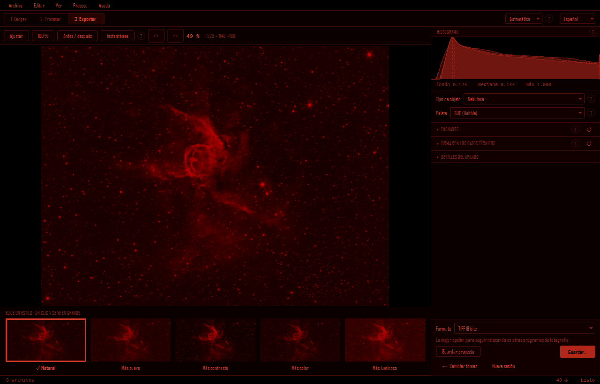

### Atajos de teclado y ratón

| Acción | Atajo / Gesto |
|---|---|
| Abrir proyecto `.pixastro` | `Ctrl+O` |
| Guardar proyecto `.pixastro` | `Ctrl+S` |
| Exportar imagen | `Ctrl+E` |
| Salir de PixAstro | `Ctrl+Q` |
| Deshacer / Rehacer ajuste | `Ctrl+Z` / `Ctrl+Y` o `Ctrl+Shift+Z` |
| Quitar tomas seleccionadas (en Cargar) | `Supr` (`Delete`) |
| Selección múltiple de tomas (en Cargar) | `Ctrl+clic` / `Mayús+clic` |
| Zoom / Desplazar imagen en el visor | Rueda del ratón / Arrastrar |
| Comparar con la cortina Antes / después | Arrastrar la línea divisoria vertical |
| Navegar con la miniatura (Navegador) | Clic o arrastre en el recuadro inferior derecho al hacer zoom |
| Poner o quitar umbral de calidad (en Procesar) | Arrastrar sobre la gráfica / Doble clic |
| Forzar uso de una toma descartada (en Procesar) | Clic derecho sobre su barra roja |

---

## 4. Paso 1: Cargar tomas y traer sesiones por red

En la pantalla **1 Cargar**, añades todas tus tomas (lights, darks, flats, bias o un apilado previo), revisas la detección automática, inspeccionas cada archivo y preparas la sesión.

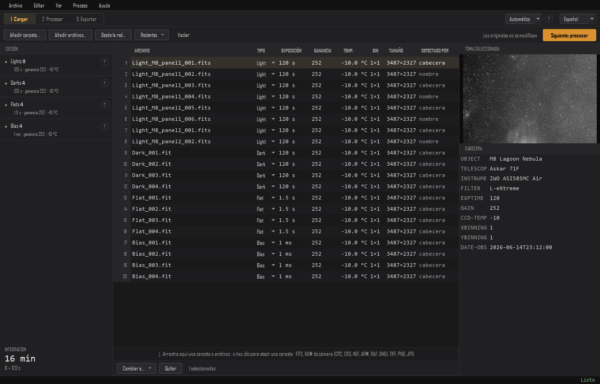

### Formatos admitidos y limpieza automática

- **Formatos compatibles**:
  - **FITS sin comprimir** (`.fit`, `.fits`, `.fts`): monocromo, color RGB o mosaico Bayer (CFA).
  - **RAW de cámara**: `.cr2`, `.cr3`, `.nef`, `.arw`, `.raf`, `.dng`, `.orf`, `.rw2`, `.pef`, `.srw` (vía LibRaw).
  - **TIFF** de 16 o 32 bits (`.tif`, `.tiff`), **PNG** (`.png`) y **JPG** (`.jpg`, `.jpeg`).
- **Archivos ignorados automáticamente**: las miniaturas (`_thn`, `_thumb`, `_thumbnail`, `_preview`) que generan ASIAIR o Seestar, las vistas previas `stacked*` del Dwarf y el JPG acompañante del modo RAW+JPEG de las cámaras réflex se excluyen automáticamente cuando hay tomas RAW/FITS de la misma sesión.
- **No admitidos**: archivos FITS comprimidos con `fpack` (`.fz`); guárdalos sin compresión en tu software de captura o descomprímelos con `funpack`.
- **Recomendación**: usa siempre RAW o FITS frente a JPG/PNG (estos últimos ya traen curva de tono, enfoque y compresión de cámara que degradan la calibración).

### Formas de cargar tomas

1. **Arrastrar y soltar**: arrastra carpetas enteras o archivos sueltos sobre la zona central (o haz clic en ella para abrir el selector).
2. **Botones de la barra superior**:
   - **Añadir carpeta…**: añade una carpeta y sus subcarpetas.
   - **Añadir archivos…**: añade tomas concretas.
   - **Desde la red…**: copia e importa tomas directamente desde un telescopio inteligente o controlador en red local (detallado a continuación).
   - **Recientes**: menú desplegable con las últimas 10 carpetas usadas (muy útil para añadir con un clic tu carpeta habitual de darks, flats o bias).
   - **Vaciar**: limpia toda la lista de tomas (sin borrar ningún archivo del disco).

### Traer tomas directamente del telescopio por red (`Desde la red…`)

Con **Desde la red…** puedes importar tus sesiones sin cables ni memorias USB desde telescopios y controladores en tu Wi-Fi o red local (o conectando el ordenador directamente al punto de acceso Wi-Fi del telescopio):

- **Equipos compatibles y direcciones habituales en su Wi-Fi propio**:
  - **ZWO ASIAIR** (SMB/Samba).
  - **ZWO Seestar** (SMB — `10.0.0.1` en su propio Wi-Fi).
  - **Dwarf 3 y Dwarf mini** (FTP anónimo — `192.168.88.1` en su propio Wi-Fi; puedes anteponer `ftp://` si quieres forzar FTP).
  - **Celestron Origin** (SMB — `origin.local`).
  - **Vaonis Vespera** (FTP/SMB — `10.0.0.1` en su propio Wi-Fi).
  - **Otros equipos** (mini PC con Windows, Raspberry Pi con Samba, servidores FTP de red local).

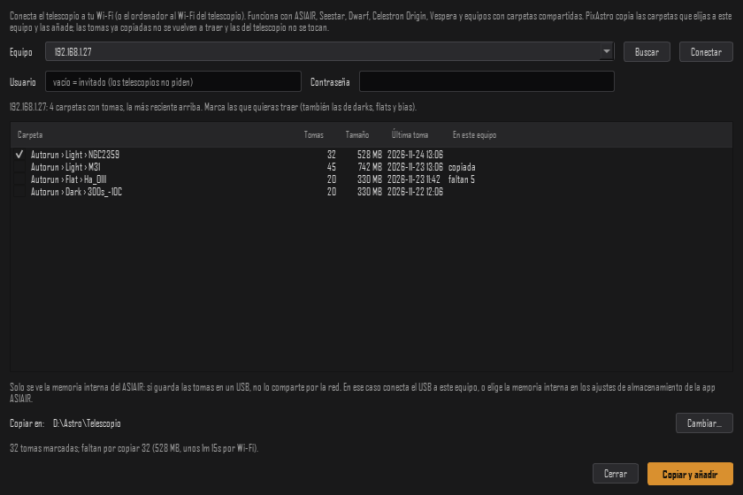

1. Pulsa **Buscar** para localizar automáticamente dispositivos compatibles en la red local; PixAstro identifica ASIAIR, Seestar, Dwarf, Celestron Origin y Vespera con su dirección IP y nombre. También puedes escribir la IP o nombre (`origin.local`) manualmente en **Equipo** y pulsar **Conectar**.
2. Para telescopios, deja **Usuario** y **Contraseña** vacíos (acceso como invitado / FTP anónimo). Otros equipos Windows o Linux con carpetas privadas pueden requerir credenciales.
3. En la tabla de carpetas (ordenadas de la más reciente arriba a la más antigua) marca las casillas de las sesiones que quieras copiar (incluyendo darks, flats y bias si existen). La columna **En este equipo** indica si la carpeta ya está `copiada` o cuántas tomas faltan (`faltan N`).
4. Ajusta la carpeta destino con **Cambiar…** (por defecto en *Imágenes/PixAstro/<nombre del equipo>*).
5. Pulsa **Copiar y añadir**. Las tomas ya copiadas con el mismo tamaño se saltan (transferencia incremental), las descargas interrumpidas nunca dejan archivos a medias (usan sufijo `.part`), nada en el telescopio se modifica y al finalizar las carpetas copiadas se cargan automáticamente en la tabla.

> [!IMPORTANT]
> **Opciones de guardado y almacenamiento USB**: Algunos telescopios inteligentes solo conservan las tomas individuales si activas la opción correspondiente en su aplicación: **`Save Each Frame`** en **Seestar**, **`Save Raw Images`** en **Celestron Origin** y **`RAW images (FITS)`** en **Vespera**. En el **ASIAIR**, por red solo es visible la memoria interna (`EMMC Images`); si configuras la app ASIAIR para guardar en un USB externo, esa unidad no se comparte por red y deberás conectarla físicamente al ordenador.

### Panel de sesión, clasificación y avisos

En el **panel izquierdo (`SESIÓN`)** se resumen los cuatro tipos de tomas con su recuento, exposición, ganancia/ISO y temperatura comunes, junto a la **Integración total** calculada de los lights:

- **Lights** (tomas de luz del objeto): punto verde si hay lights; rojo si faltan.
- **Darks** (tomas oscuras con tapa, igual exposición y temperatura): corrigen píxeles calientes y brillo térmico/amp glow.
- **Flats** (tomas de campo plano sin tocar el enfoque): corrigen el viñeteo y las motas de polvo.
- **Bias** (tomas de menor exposición con tapa): nivel base del sensor, útiles para calibrar flats y escalar darks.

Si falta algún tipo de calibración, existen discrepancias de cámara/tamaño/ganancia/temperatura entre calibración y lights, hay menos de 5 lights, existen archivos dañados (marcados en rojo) o estás cargando un apilado previo, aparecen **avisos desplegables** en la parte inferior del panel izquierdo explicando el impacto exacto. Si activaste la **Biblioteca de calibración** y faltan darks en la carpeta, PixAstro te avisará si va a usar automáticamente unos compatibles guardados anteriormente.

### Tabla de tomas, edición manual y vista previa

- **Columnas**: `Archivo`, `Tipo`, `Exposición`, `Ganancia`, `Temp.`, `Bin`, `Tamaño` y `Detectado por` (`cabecera`, `nombre`, `contenido` o `tú`).
- **Corregir el tipo manualmente**: cambia el desplegable de la columna **Tipo** en cualquier fila, o selecciona varias filas con `Ctrl` / `Mayús` y usa **Cambiar a…** o el menú contextual (clic derecho) para reclasificarlas en bloque.
- **Quitar tomas de la sesión**: selecciona una o varias filas y pulsa **Quitar**, clic derecho → **Quitar** o la tecla `Supr` (solo las saca de la lista, nunca borra archivos del disco).
- **Panel derecho (`TOMA SELECCIONADA` y `CABECERA`)**: al pulsar cualquier fila, muestra una vista previa estirada automáticamente para inspeccionar encuadre, enfoque o nubes, y debajo las etiquetas técnicas de su cabecera FITS o metadatos RAW/TIFF.

### Casos especiales que PixAstro resuelve automáticamente

- **Imágenes ya apiladas**: si cargas un único archivo generado por PixInsight, Siril, DeepSkyStacker, Astro Pixel Processor, ASTAP, Sequator o por el propio PixAstro (FITS 32 bits), el programa detecta que ya es un apilado, omite calibración/alineado/apilado y pasa directamente al recorte de bordes y acabado.
- **Cámaras monocromo con rueda de filtros**: carga juntos los lights de todos los filtros y sus flats. PixAstro identifica el filtro por la cabecera `FILTER`, por el nombre de carpeta o archivo (`L`, `Lum`, `R`, `Red`, `G`, `B`, `Ha`, `OIII`, `SII`, etc.), apila cada canal con sus flats y los combina en **LRGB**, **RGB**, **HOO** o **SHO**. Si cargas filtros de banda estrecha junto a tomas RGB, combina el detalle de la nebulosa con el color real de las estrellas RGB.
- **Cámaras a color con filtros duales**: reconoce filtros como L-eXtreme, L-eNhance, L-Ultimate, ALP-T, SV220, Askar C1/C2/D1/D2, L-Synergy o Seestar en modo dual-band, y también distingue filtros de banda ancha/antipolución/tribanda RGB (`UV/IR`, `L-Pro`, `LPS`, `Tri-Band RGB Ultra`). Si combinas una sesión Hα/OIII con otra SII/OIII compone en **SHO**; si combinas una sesión dual Hα/OIII con una de color normal compone en **HaRGB** reforzando la nebulosa sin alterar el color de las estrellas.
- **Tomas de distintas exposiciones y fusión HDR**: iguala la señal y pondera cada toma según su ruido; si las exposiciones difieren en más de 1,5× y existen zonas saturadas en las largas (como el núcleo de M42 o M31), fusiona en **HDR** recuperando el núcleo desde las tomas cortas.
- **Mosaicos multipanel**: carga en bloque las tomas de varios paneles solapados (se recomienda ≥ 15 % de solape); PixAstro agrupa cada campo, apila cada panel por separado y los une igualando fondo y transición sin costuras (también funciona con paneles ya apilados de distintos tamaños).

Pulsa **Siguiente: procesar** cuando tus tomas estén listas.

---

## 5. Paso 2: Procesar y apilar

En la pantalla **2 Procesar** se ejecuta el núcleo de calibración, análisis, alineado, apilado y posprocesado inicial.

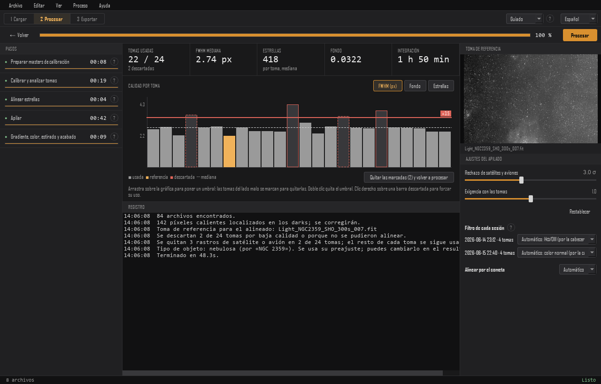

### Las 5 fases del procesado

1. **Preparar masters de calibración**: promedia bias, darks y flats. Descarta automáticamente flats sobreexpuestos y, mediante optimización adaptativa de darks, mide qué fracción del detalle fino de los darks se repite realmente en los lights para evitar inyectar ruido de darks ruidosos.
2. **Calibrar y analizar tomas**: aplica masters y localiza píxeles calientes persistentes. Mide en cada light número de estrellas, nitidez (**FWHM**), redondez (**excentricidad**), nivel de **fondo** y ruido, descartando las tomas claramente degradadas.
3. **Alinear estrellas**: detecta asterismos estelares y alinea cada toma sobre la toma de referencia (o, en modo cometa, realiza también un alineado independiente sobre el núcleo del cometa).
4. **Apilar**: aplica rechazo iterativo de píxeles atípicos (`kappa`) para eliminar satélites, aviones, rayos cósmicos y píxeles calientes, detecta y elimina trazos lineales largos dentro de cada toma sin perder el resto de la imagen, compensa diferencias de exposición y limpia ruido mediante medias pilas / red neuronal. Si hay varios paneles, ensambla el mosaico.
5. **Gradiente, color, estirado y acabado**: recorta los bordes no cubiertos por todas las tomas y ejecuta el posprocesado inicial según el tipo de objeto detectado.

### Panel central: cifras, gráfica interactiva y registro

- **Tarjetas de métricas**: `Tomas usadas` (y descartadas), `FWHM mediana` (en píxeles), `Estrellas` (mediana por toma), `Fondo` y `Integración` total efectiva.
- **Gráfica interactiva `CALIDAD POR TOMA`**:
  - Cambia la métrica visualizada con los botones **`FWHM (px)`**, **`Fondo`** y **`Estrellas`**.
  - Leyenda de barras: gris (**usada**), ámbar (**referencia**), borde rojo sólido (**descartada**), línea horizontal discontinua (**mediana**). Al pasar el cursor muestra nombre, FWHM, estrellas y fondo exactos de la toma.
  - **Recortar tomas por umbral**: al terminar el análisis o apilado, **arrastra verticalmente sobre la gráfica** para fijar un límite rojo (p. ej., `≤ 3.5` en FWHM o `≥` en Estrellas). Las barras que queden en el lado malo se marcan con contorno rojo discontinuo y aparece el botón **Quitar las marcadas (N) y volver a procesar**. Haz **doble clic** en la gráfica para eliminar el umbral.
  - **Forzar una toma descartada**: haz **clic derecho** sobre cualquier barra roja descartada para forzar su inclusión (se marca con contorno ámbar discontinuo) y pulsa **Usar también las forzadas (N) y volver a procesar** (no puede forzar tomas sin estrellas suficientes o imposibles de alinear).
- **Registro (`REGISTRO`)**: bitácora con marca de tiempo de cada evento, detecciones y avisos importantes (en ámbar).
- **Panel derecho (`TOMA DE REFERENCIA` / `APILADO PARCIAL`)**: antes de apilar muestra la toma elegida como referencia; durante el apilado va mostrando una vista previa en vivo del **apilado parcial** con las tomas acumuladas hasta ese momento.

### Ajustes de apilado en Modo Guiado

Si cambias el selector superior a **Guiado**, el panel derecho habilita los ajustes avanzados antes de pulsar **Procesar**:

| Ajuste | Rango / Opciones | Función |
|---|---|---|
| **Rechazo de satélites y aviones (`kappa`)** | `1.5 σ` – `5.0 σ` (por defecto `3.0 σ`) | Desviación respecto al resto de tomas para descartar píxeles anómalos. Valores bajos eliminan más trazos (y algo de señal); valores altos conservan más señal. |
| **Exigencia con las tomas (`strictness`)** | `0.0` – `2.0` (por defecto `1.0`) | Severidad al descartar tomas borrosas, movidas o nubladas. `0.0` conserva todas las tomas alineables. |
| **Filtro de cada sesión** | `Automático`, `Color normal`, `Dual Hα/OIII → HOO`, `Dual SII/OIII` | Aparece cuando hay sesiones de cámara a color (separadas por >8 h o por carpeta). Permite indicar o corregir manualmente el filtro usado en cada noche. |
| **Alinear por el cometa** | `Automático`, `Sí`, `No` | Separa con IA las estrellas del cometa, apila el cometa alineado por su núcleo y las estrellas por sí mismas (descartando defectos fríos, bordes sin señal y brillos anómalos en estrellas variables), y vuelve a unirlos para obtener estrellas puntuales y cometa nítido. En `Automático` se activa si el nombre del objeto corresponde a un cometa (p. ej. `161P`, `C/2025 A6`). Requiere al menos 4 marcas horarias distintas en `DATE-OBS`. |
| **Restablecer** | Botón | Devuelve `3.0 σ`, `1.0`, filtro automático y modo cometa automático. |

---

## 6. Paso 3: Resultado, ajustes guiados, encuadre, firma y exportación

En la pantalla **3 Exportar** puedes comparar, cambiar de estilo o tipo de objeto, ajustar todos los pasos del posprocesado con vista previa en vivo, encuadrar, añadir firma técnica y etiquetas astrométricas, y guardar en el formato final.

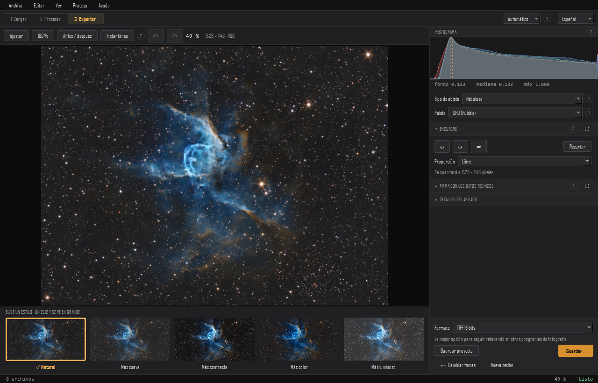

### Visor, comparación antes/después, instantánea e historial

La barra superior del visor contiene:

- **Ajustar** / **100 %**: ajusta la imagen a la ventana o muestra escala real 1:1 (al hacer zoom por encima de la resolución de vista previa, PixAstro calcula automáticamente la imagen a resolución completa en segundo plano). Cuando la imagen es mayor que el visor, aparece un **Navegador** en miniatura en la esquina inferior derecha para desplazarte con un clic.
- **Antes / después**: muestra una cortina vertical interactiva; arrástrala para comparar a la izquierda el apilado inicial (solo aclarado) y a la derecha el resultado actual.
- **Instantánea**: fija la imagen tal y como se ve *en ese instante* como lado «antes» de la cortina (aparece un botón **×** al lado para volver al apilado original). Es ideal para evaluar ajustes finos sucesivos.
- **↶ / ↷ (`Ctrl+Z` / `Ctrl+Y`)**: historial de hasta 100 pasos de deshacer/rehacer (incluye parámetros, preajuste y encuadre).
- **Indicador de zoom y tamaño** (`48 % · 1529 × 1146 · RGB` o `mono`), y estado de cálculo en vivo (`Actualizando vista previa…`, `Calculando a resolución completa… %`).

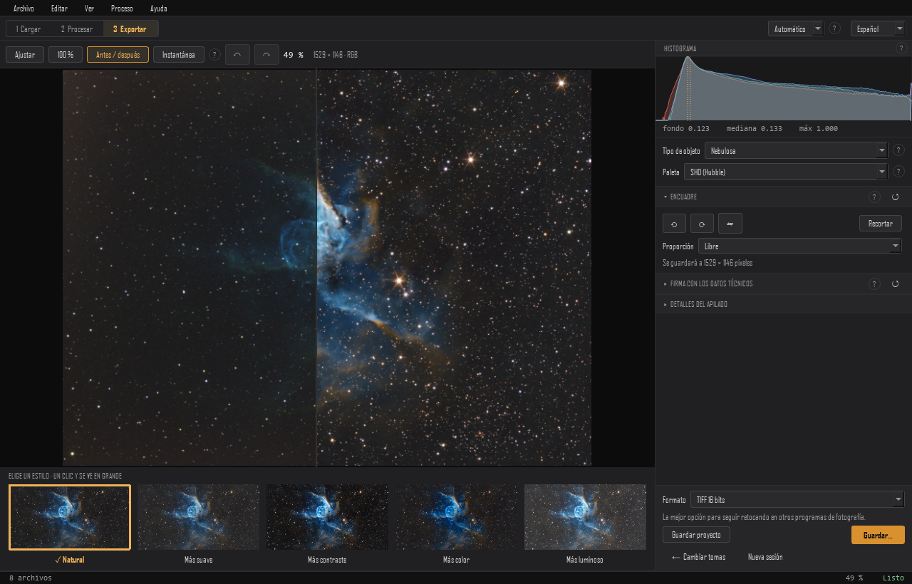

### Histograma, tipo de objeto, paleta y estilos rápidos

En la parte superior del panel derecho dispones de controles comunes a Automático y Guiado:

- **Histograma logarítmico por canales** + botón **?**: muestra la distribución de luminancia/RGB junto a las líneas punteadas de `fondo`, `mediana` y el pico `máx`. Un pico separado del borde izquierdo indica que el cielo no está recortado.
- **Tipo de objeto (`Preset`)**: `General`, `Nebulosa`, `Galaxia`, `Cúmulo de estrellas`, `Vía Láctea (gran campo)`. PixAstro lo detecta por el nombre del objeto o el color difuso de la imagen, y puedes cambiarlo al instante para adaptar estirado, protección del objeto, enfoque y reducción de estrellas.
- **Paleta** *(visible en imágenes en color y banda estrecha)*:

| Paleta | Uso / Resultado |
|---|---|
| **Automática** | Usa la paleta natural para los filtros cargados (SHO, HOO o color normal). |
| **SHO (Hubble)** | Azufre en rojo, hidrógeno (atenuado para evitar exceso de verde) en verde y oxígeno en azul: nebulosa dorada y oxígeno azul. |
| **HOO (Hα y OIII)** | Hidrógeno en rojo y oxígeno en azul verdoso (teal). |
| **HOS (Hα, OIII, SII)** | Hidrógeno en rojo, oxígeno en verde y azufre en azul. |
| **HSO (Hα, SII, OIII)** | Hidrógeno en rojo, azufre en verde y oxígeno en azul. |
| **Natural (visión humana)** | Simula la percepción visual del ojo (rojo SII/Hα, OIII en verde y azul). |
| **Estilo Hubble (sintético)** | Emula la estética dorada/azul Hubble a partir de datos únicamente de Hα y OIII (sin SII real). |
| **SHO sin retocar (verde)** | Cada línea pura en su canal RGB sin atenuar el verde dominante del Hα. |
| **Color natural** | Fuerza el procesado como banda ancha RGB normal (útil si un filtro dual/banda ancha fue mal interpretado). |

- **Estilos rápidos (en Modo Automático)**: franja inferior con 5 miniaturas generadas sobre tu propia imagen (**`Natural`**, **`Más suave`**, **`Más contraste`**, **`Más color`**, **`Más luminoso`**). Basta un clic para aplicar el estilo en grande.

### Referencia completa del Modo Guiado (7 tarjetas de ajuste)

Al cambiar a **Modo Guiado** aparecen siete tarjetas plegables. Cada tarjeta incluye botón **?** con explicación y botón **↺** para volver exclusivamente ese paso a su valor automático.

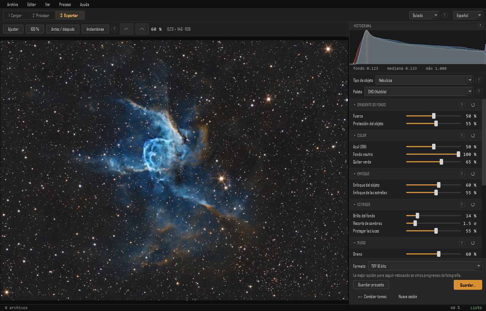

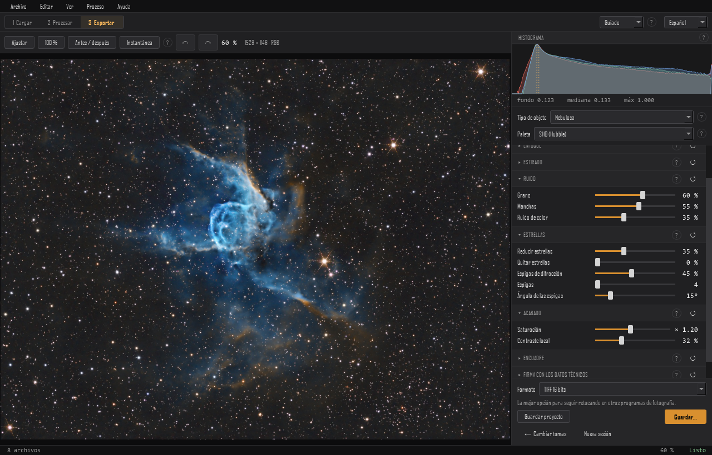

| Tarjeta | Deslizador | Rango | Función |
|---|---|---|---|
| **Gradiente de fondo** | `Fuerza` | `0 %` – `100 %` | Modela y resta la iluminación desigual (contaminación lumínica, Luna, horizonte). `0 %` no modifica el fondo; valores altos corrigen gradientes complejos (pueden oscurecer nebulosas muy extensas). |
| **Gradiente de fondo** | `Protección del objeto` | `0 %` – `100 %` | Evita que el objeto cuente como fondo al calcular el modelo. Súbelo en nebulosas o Vía Láctea que llenan el campo. |
| **Color** | `Balance de blancos` / `Azul (OIII)` | `0 %` – `100 %` | En RGB calibra las estrellas para que promedien blanco (`0 %` = crudo de cámara). En composiciones **SHO**, controla el aporte azul del OIII (centro `50 %` = estándar; de mitad a doble). |
| **Color** | `Fondo neutro` | `0 %` – `100 %` | Neutraliza el tinte residual del cielo (verde, naranja de farolas…). |
| **Color** | `Quitar verde` | `0 %` – `100 %` | Elimina el tinte verde del sensor (SCNR). Bájalo si fotografías cometas, cuya coma es realmente verde. |
| **Enfoque** *(IA offline)* | `Enfoque del objeto` | `0 %` – `100 %` | Deconvolución por red neuronal propia: recupera detalle fino en polvo, filamentos y brazos sin anillos ni grano extra. |
| **Enfoque** *(IA offline)* | `Enfoque de las estrellas` | `0 %` – `100 %` | Afina y redondea las estrellas independientemente del objeto (incluso en las esquinas). |
| **Estirado** | `Brillo del fondo` | `8 %` – `40 %` | Nivel al que queda el cielo tras estirar. Súbelo para sacar nebulosas débiles (aumenta también la visibilidad del ruido). |
| **Estirado** | `Recorte de sombras` | `1.0 σ` – `4.5 σ` | Distancia desde la mediana del cielo hasta el punto negro. Más alto = negro más lejano (menos contraste y velo gris). |
| **Estirado** | `Proteger las luces` | `0 %` – `100 %` | Compresión HDR de zonas muy brillantes y compactas (centro de M42, núcleo de M31, nebulosas compactas como M57 o halos de estrellas intensas) para no quemarlas. |
| **Ruido** *(IA offline)* | `Grano` | `0 %` – `100 %` | Suaviza el grano fino (1–2 px) del fondo oscuro respetando estrellas y estructura del objeto. |
| **Ruido** | `Manchas` | `0 %` – `100 %` | Suaviza ondulaciones y manchas de ruido de escala media/grande (4–32 px) independientemente del grano fino. |
| **Ruido** | `Ruido de color` | `0 %` – `100 %` | Elimina motas verdes/magenta del fondo (puede subirse bastante sin perder detalle). |
| **Estrellas** | `Reducir estrellas` | `0 %` – `100 %` | Encoge el diámetro de las estrellas para despejar nebulosas. En cúmulos estelares conviene mantenerlo bajo. |
| **Estrellas** *(IA offline)* | `Quitar estrellas` | `0 %` – `100 %` | Elimina las estrellas mediante red neuronal propia (`100 %` = solo nebulosa/galaxia; valores intermedios atenúan estrellas). Al exportar TIFF/PNG/JPG con valor `> 0`, guarda automáticamente un segundo archivo `*-estrellas` con la capa estelar. |
| **Estrellas** | `Espigas de difracción` | `0 %` – `100 %` | Añade espigas físicas calculadas ópticamente con el color real de cada estrella (largas en estrellas brillantes, cortas en medianas). |
| **Estrellas** | `Espigas` | `4` o `6` | Número de espigas (araña de 2 aspas en cruz o 3 aspas). |
| **Estrellas** | `Ángulo de las espigas` | `0°` – `90°` | Rotación en grados de las espigas. |
| **Acabado** | `Saturación` | `× 0.50` – `× 2.00` | Intensidad perceptual del color protegiendo el fondo oscuro para no saturar el ruido. |
| **Acabado** | `Contraste local` | `0 %` – `100 %` | Realza filamentos, brazos espirales y nubes de polvo sin alterar el fondo. |

### Encuadre (girar, voltear y recortar)

La tarjeta **ENCUADRE** funciona tanto en Automático como en Guiado:

- **Girar a la izquierda (`⟲`) / Girar a la derecha (`⟳`)**: rotaciones exactas de 90° sin pérdida ni interpolación.
- **Voltear (espejo) (`⇋`)**: reflexión horizontal.
- **Recortar / Hecho**: activa el rectángulo de recorte con guías de **regla de los tercios** sobre el visor. Arrastra sus lados, esquinas o el interior para reencuadrar y pulsa **Hecho** cuando termines.
- **Proporción**: `Libre`, `Original`, `1:1`, `3:2`, `2:3`, `4:5`, `16:9`, `9:16`.
- Debajo se indica la resolución exacta resultante (`Se guardará a W × H píxeles`). **El procesado siempre se calcula sobre la imagen completa**, por lo que recortar nunca altera el balance de color ni el brillo. El botón **↺** restablece el giro, espejo y recorte.

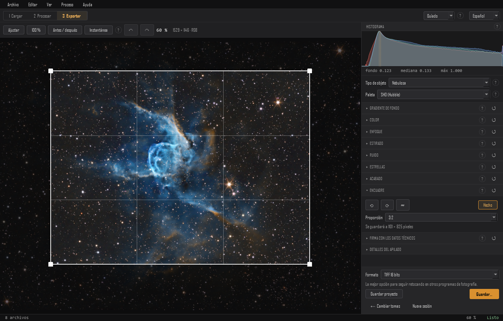

### Firma técnica y etiquetado de objetos del cielo (ASTAP)

La tarjeta **FIRMA CON LOS DATOS TÉCNICOS** permite estampar automáticamente una cartela profesional y anotaciones astrométricas al exportar en **TIFF**, **PNG** o **JPG** (el FITS lineal siempre se guarda limpio, sin texto ni marcas):

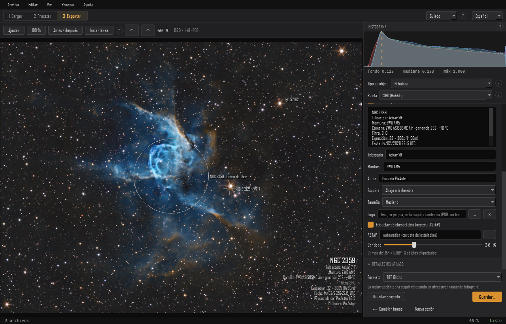

- **Añadir al guardar**: activa la cartela con nombre de objeto (primera línea en grande), telescopio, montura, cámara, ganancia, temperatura, filtro, exposición total, fecha UTC y crédito de PixAstro. El texto es **totalmente editable** en el cuadro multilínea (botón **↺** vuelve al texto propuesto).
- **Telescopio** y **Montura**: si los rellenas manualmente (por ejemplo, si el ASIAIR escribió la montura en `TELESCOP`), PixAstro los **recuerda automáticamente para cada cámara**.
- **Autor** (`©`), **Esquina** (`Abajo a la izquierda`, `Abajo a la derecha`, `Arriba a la izquierda`, `Arriba a la derecha`), **Tamaño** (`Pequeño`, `Mediano`, `Grande`, `Muy grande`).
- **Logo**: selecciona una imagen propia (preferiblemente PNG con transparencia) para colocarla en la esquina opuesta del mismo borde.
- **Etiquetar objetos del cielo (necesita ASTAP)**:
  1. Requiere tener instalado [**ASTAP**](https://www.hnsky.org/astap.htm) (gratuito) junto con una base de datos estelar y su catálogo `deep_sky.csv`.
  2. PixAstro detecta ASTAP en las rutas estándar de instalación o puedes indicar su ejecutable manualmente con el botón **…**.
  3. Resuelve el campo mediante *plate solving*, muestra el tamaño real del campo en grados y los objetos etiquetados, y dibuja en la imagen círculos proporcionales para objetos de cielo profundo (Messier, NGC, IC, Sharpless, Barnard, LDN/LBN, etc.) y retículas para estrellas notables.
  4. El deslizador **Cantidad** (`0 %` – `100 %`, por defecto `30 %`) regula el nivel de detalle en vivo: a la izquierda muestra solo los objetos principales; hacia la derecha añade objetos de catálogos menores, nebulosas oscuras sin nombre y más estrellas.

### Detalles del apilado, avisos y exportación

- **DETALLES DEL APILADO**: despliega el resumen completo (tomas apiladas, exposición, dimensiones, paneles de mosaico, toma de referencia y duración) y la lista de todas las tomas con `★` (referencia), `✓` (usada con sus estrellas y FWHM) y `✗` (descartada con motivo exacto). Debajo aparecen los avisos de sesión o de equipo óptico detectados.
- **Formatos de guardado**:

| Formato | Profundidad | Perfil / Metadatos | Uso recomendado |
|---|---|---|---|
| **TIFF 16 bits** | 16 bits por canal (zlib) | Estirada, perfil **sRGB** ICC + metadatos JSON | La mejor opción para retoque posterior en Photoshop, Lightroom, GIMP o Affinity. |
| **FITS 32 bits** | 32 bits flotante (`TOP-DOWN`) | **Datos lineales sin estirar** ni firma + cabeceras FITS (`PIXSTACK`) | Para reabrir en PixAstro otro día sin volver a apilar o continuar en software astronómico (se verá casi negro en visores normales). |
| **PNG 16 bits** | 16 bits por canal | Estirada, bloque **sRGB** + `gAMA` + texto UTF-8 | Compartir en alta calidad sin pérdidas de compresión. |
| **JPG** | 8 bits (calidad 95 %) | Estirada, perfil **sRGB** ICC + comentario UTF-8 | Compartir en redes sociales o mensajería con tamaño compacto. |

- **Guardar proyecto**: guarda archivo `.pixastro` con toda la sesión y el apilado lineal.
- **← Cambiar tomas**: vuelve a `1 Cargar` conservando todas las tomas cargadas para añadir o quitar archivos y reprocesar.
- **Nueva sesión**: limpia la sesión actual tras confirmar si hay cambios sin guardar.

---

## 7. Proyectos, Cola de objetos y Biblioteca de calibración

### Proyectos de PixAstro (`.pixastro`)

Disponible desde **Archivo → Guardar proyecto…** (`Ctrl+S`), **Archivo → Abrir proyecto…** (`Ctrl+O`) o el botón **Guardar proyecto** del paso 3:

- Guarda la lista de tomas y su clasificación, el apilado lineal ya calculado, los parámetros `kappa`/`strictness`, los ajustes de posprocesado del Modo Guiado, el preajuste y el encuadre.
- Al volver a abrirlo (o arrastrar el `.pixastro` a la ventana), reanudas instantáneamente en el paso 3 sin volver a apilar.
- **Detección de cambios**: si añadiste, quitaste o modificaste las tomas en disco desde que guardaste el proyecto, PixAstro lo detecta, te avisa y conserva tu clasificación y ajustes listos para volver a apilar.
- **Protección contra cierres**: si intentas cerrar la ventana o iniciar una sesión nueva con un resultado sin guardar (ni imagen exportada ni proyecto), PixAstro pregunta si deseas **Guardar proyecto…**, **Descartar** o **Cancelar**.

### Cola de objetos (`Archivo → Cola de objetos…`)

La **Cola de objetos** procesa múltiples carpetas de cielo profundo una tras otra en **Modo Automático** sin afectar al proyecto abierto en la ventana principal — ideal para dejar varias sesiones procesándose durante la noche.

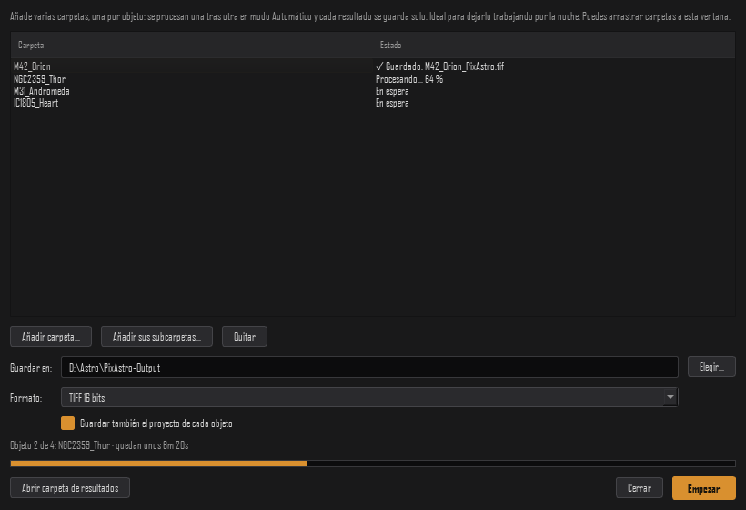

1. Añade carpetas arrastrándolas a la ventana, con **Añadir carpeta…** o con **Añadir sus subcarpetas…** (por ejemplo, selecciona la carpeta `Light` de ASIAIR y se encolará cada objeto contenido en ella).
2. Elige la carpeta destino con **Elegir…** y el formato de exportación (`TIFF 16 bits`, `FITS 32 bits`, `PNG 16 bits` o `JPG`).
3. Marca **Guardar también el proyecto de cada objeto** si quieres que, además de la imagen final, genere un `.pixastro` por cada objeto para poder retocarlo después en Modo Guiado sin reapilar.
4. Pulsa **Empezar**. Verás el estado individual (`En espera`, `Procesando… %`, `✓ Guardado` o `✗` si alguno falló sin detener los demás) y el tiempo restante total.
5. Si cancelas a mitad, las imágenes y proyectos de los objetos ya completados permanecen guardados. Pulsa **Abrir carpeta de resultados** para ir directamente a ellos.

### Biblioteca de calibración

Activada por defecto (**Proceso → Usar la biblioteca de calibración**):

- Cada vez que procesas una sesión que incluye al menos **5 darks o 5 bias**, PixAstro guarda sus masters junto con la ficha técnica de la cámara (modelo `INSTRUME`, dimensiones, patrón Bayer, ganancia, offset, binning, temperatura y exposición) en la carpeta `calibracion`.
- Cuando cargues otra sesión sin darks o sin bias, PixAstro busca automáticamente un master compatible de esa misma cámara (tolerancia de **±3 °C** de temperatura, ganancia equivalente y exposición dentro de **±5 %** — o hasta el doble/la mitad si hay bias para escalar la corriente oscura) y lo aplica de forma segura.
- **Los flats nunca se guardan en la biblioteca**, ya que las motas de polvo y la rotación óptica cambian entre sesiones y un flat desactualizado degradaría la imagen.
- El espacio máximo de la biblioteca está limitado a **4 GB** (borra automáticamente los masters menos usados si supera el límite). Puedes inspeccionarla o vaciarla desde **Proceso → Abrir la carpeta de la biblioteca de calibración**.

---

## 8. Línea de comandos (CLI)

El mismo ejecutable de escritorio funciona sin interfaz gráfica desde cualquier terminal (PowerShell/CMD en Windows, Terminal en Linux/macOS):

- **Windows**: `PixAstro.exe` (o `.venv\Scripts\python -m pixastro` desde código fuente)
- **Linux**: `./PixAstro`
- **macOS**: `/Applications/PixAstro.app/Contents/MacOS/PixAstroApp`

### Opciones globales y subcomandos

| Opción / Subcomando | Descripción |
|---|---|
| `--version` | Muestra la versión instalada. |
| `--lang {de,en,es,fr,it,pt,zh}` | Selecciona el idioma de los mensajes en consola. |
| `analyze <entradas...>` | Muestra cómo clasifica PixAstro cada toma (`Light`/`Dark`/`Flat`/`Bias`) y el motivo de detección sin procesar. |
| `process <entradas...> -o <salida>` | Ejecuta el flujo completo de calibración, alineado, apilado y posprocesado y guarda la imagen final. |

#### Parámetros de `process`

| Opción | Por defecto | Descripción |
|---|---|---|
| `-o`, `--output` *(obligatorio)* | — | Archivo de salida (`.tif`, `.fits`, `.png`, `.jpg`). |
| `-f`, `--format` | según extensión | Fuerza formato (`tiff`, `fits`, `png`, `jpg`). |
| `--kappa <valor>` | `3.0` | Rechazo de píxeles en desviaciones estándar (`0` = media simple). |
| `--strictness <valor>` | `1.0` | Exigencia al descartar tomas (`0` = ninguna, `1` = normal, `2` = alta). |
| `--preset` | `auto` | Tipo de objeto: `auto`, `nebula`, `galaxy`, `cluster`, `milkyway`. |
| `--no-crop` | desactivado | No recorta automáticamente los bordes tras el apilado. |
| `--no-mosaic` | desactivado | Si hay varios campos, procesa solo el campo de la mejor toma sin unir mosaico. |
| `--temp <carpeta>` | temporal del sistema | Directorio personalizado para archivos temporales. |

### Ejemplos de uso

```bash
# Clasificar una sesión sin procesarla
PixAstro.exe analyze "D:\Astro\M42"

# Procesar una nebulosa guardando en TIFF de 16 bits
PixAstro.exe process "D:\Astro\M42" -o "D:\Astro\M42_final.tif" --preset nebula

# Procesar en inglés con rechazo de satélites más estricto y apilado lineal FITS
PixAstro.exe --lang en process "D:\Astro\M31" -o "M31.fits" --kappa 2.5 --strictness 1.5
```

---

## 9. Avisos, diagnósticos, solución de problemas y soporte

### Diagnósticos automáticos del equipo óptico

Tras analizar y alinear las tomas, PixAstro evalúa la geometría estelar a lo largo de todo el campo y la noche, mostrándote avisos específicos si detecta problemas en tu tren óptico:

- **Inclinación del sensor (*tilt*)**: las estrellas son sistemáticamente más gruesas hacia un borde concreto que en el opuesto en todas las tomas; revisa holguras o roscas del tren óptico.
- **Estrellas alargadas en las cuatro esquinas**: estrellas redondas en el centro pero estiradas radialmente o en tangente en las esquinas; indica distancia incorrecta (*backfocus*) entre el aplanador/corrector de coma y el sensor.
- **Estrellas movidas también en el centro**: fallo de guiado, desequilibrio, viento o exposición demasiado larga sin autoguiado.
- **Deriva de enfoque durante la noche**: el FWHM empeora progresivamente con el paso de las horas por enfriamiento del tubo o descenso hacia el horizonte.

### Errores frecuentes y cómo resolverlos

| Situación / Mensaje | Causa habitual | Solución |
|---|---|---|
| **«… es un FITS comprimido»** | Archivo `.fz` o comprimido con `fpack`. | Desactiva la compresión FITS en tu programa de captura o descomprímelo con `funpack`. |
| **«No se encuentran estrellas en las tomas»** | Enfoque severamente perdido, nubes o tomas diurnas de prueba. | Revisa las vistas previas en `1 Cargar` y retira las tomas sin estrellas. |
| **«Flats sobreexpuestos»** | El histograma de los flats toca el techo del sensor. | Repite los flats con menos exposición situando el pico del histograma entre un tercio y la mitad. |
| **«Darks ruidosos / de otra exposición»** | Pocos darks, distinta temperatura o exposición diferente sin bias. | Toma 20–30 darks con igual temperatura y exposición, o añade bias para permitir escalar la corriente oscura. |
| **«Mosaico reducido / demasiado grande»** | La resolución total del mosaico excede la RAM libre. | Cierra otros programas o procesa menos paneles a la vez; si no cabe completo, PixAstro ajusta la escala o procesa el panel principal. |
| **«No encuentro ASTAP / Falta deep_sky.csv»** | ASTAP no está instalado en la ruta estándar o falta su catálogo. | Instala ASTAP con una base de estrellas (`D50`/`D80`/`H18`) desde `hnsky.org/astap.htm` e indica su ruta en la tarjeta Firma. |
| **«No se puede conectar con el equipo» / carpeta vacía en red** | IP incorrecta, red Wi-Fi distinta, USB del ASIAIR o tomas sueltas desactivadas en el telescopio. | Conecta ambos equipos al mismo Wi-Fi o al punto de acceso del telescopio (**Seestar / Vespera**: `10.0.0.1`, **Dwarf**: `192.168.88.1`, **Origin**: `origin.local`) y pulsa **Buscar**. Activa *Save Each Frame* (Seestar), *Save Raw Images* (Origin) o *RAW images (FITS)* (Vespera). En ASIAIR solo se comparte por red la memoria interna (`EMMC Images`). |

### Registro de actividad y contacto

Si encuentras un error inesperado o quieres enviar una sugerencia:

1. Abre **Ayuda → Abrir carpeta del registro de actividad** para localizar el archivo `pixastro.log` más reciente.
2. Usa **Ayuda → ✉ Sugerencias o problemas…** para redactar un correo con la versión y sistema operativo ya rellenados (o copiar la dirección del autor al portapapeles) adjuntando el registro y una breve descripción de lo que estabas procesando.
